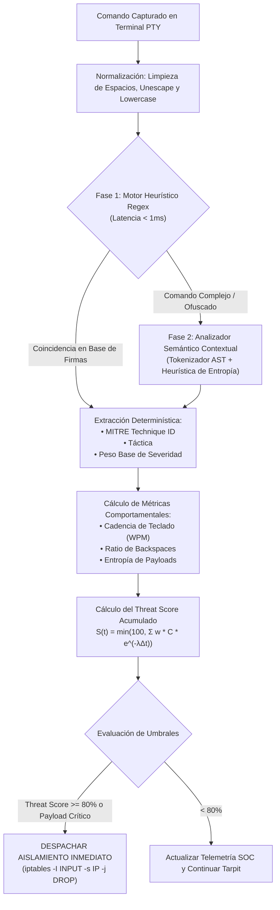
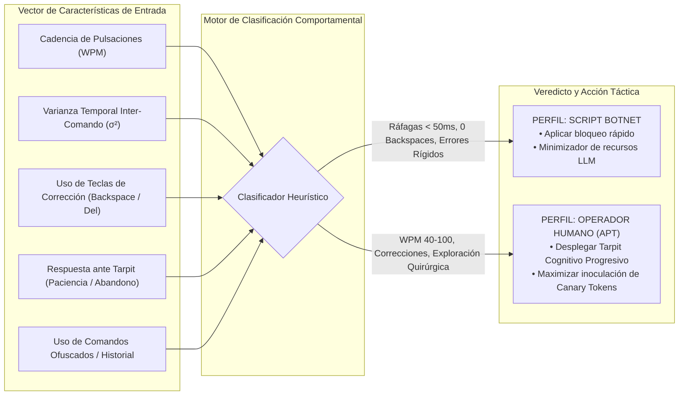

# **Honey-Agent: Matriz MITRE ATT&CK y Especificación del Motor Heurístico**

* **Documento:** Threat Intelligence & Detection Engineering Specification
* **Código de Documento:** HA-MITRE-04
* **Versión:** 1.0.0
* **Estado:** Aprobado para Implementación
* **Clasificación:** Confidencial / Detección y Análisis de Amenazas

---

## **1. Arquitectura del Motor de Clasificación Táctica**

El subsistema de inteligencia táctica de **Honey-Agent** traduce la actividad del atacante en tiempo real hacia la taxonomía formal **MITRE ATT&CK Enterprise (v14/v15)**. El motor opera bajo una arquitectura de doble fase para combinar velocidad extrema de decisión con capacidad analítica profunda:



---

## **2. Mapeo Exhaustivo a la Matriz MITRE ATT&CK Enterprise**

Honey-Agent monitorea de forma exhaustiva 9 tácticas críticas del ciclo de vida del adversario en entornos Linux corporativos:

| ID MITRE | Táctica | Técnica / Subtécnica | Patrón / Comandos Característicos | Severidad Base (1-100) | Peso Táctico ($w$) |
| :--- | :--- | :--- | :--- | :--- | :--- |
| **T1082** | Discovery | System Information Discovery | `uname -a`, `cat /etc/os-release`, `cat /proc/version`, `hostnamectl` | 10 | 1.0 |
| **T1033** | Discovery | System Owner/User Discovery | `whoami`, `id`, `w`, `who`, `last`, `logname` | 10 | 1.0 |
| **T1057** | Discovery | Process Discovery | `ps aux`, `ps -ef`, `top -n 1`, `pstree`, `pgrep` | 15 | 1.0 |
| **T1083** | Discovery | File and Directory Discovery | `ls -la`, `find / -type f`, `tree`, `locate`, `dir` | 15 | 1.0 |
| **T1049** | Discovery | System Network Connections Discovery | `netstat -tulpn`, `ss -tulpn`, `lsof -i`, `arp -a` | 20 | 1.2 |
| **T1016** | Discovery | System Network Configuration Discovery | `ifconfig`, `ip addr`, `ip route`, `cat /etc/resolv.conf` | 20 | 1.2 |
| **T1003** | Credential Access | OS Credential Dumping | `cat /etc/shadow`, `unshadow`, `mimikatz`, `strings /dev/mem` | 95 | 3.5 |
| **T1552.001** | Credential Access | Credentials in Files (.env, history) | `cat .env`, `cat ~/.bash_history`, `find / -name "*.conf"` | 70 | 2.5 |
| **T1552.004** | Credential Access | Private Keys Discovery | `cat ~/.ssh/id_rsa`, `find / -name "*.pem"`, `*.key` | 85 | 3.0 |
| **T1021.004** | Lateral Movement | SSH Pivot / Remote Services | `ssh user@10.*`, `ssh -i id_rsa`, `scp`, `rsync` | 80 | 3.0 |
| **T1059.001** | Execution | Command & Scripting: Unix Shell | `/bin/sh`, `/bin/bash`, `bash -c`, `sh -i >& /dev/tcp/...` | 90 | 4.0 |
| **T1105** | Command & Control | Ingress Tool Transfer | `wget http://*`, `curl -O http://*`, `tftp`, `ftp -s` | 75 | 2.8 |
| **T1053.003** | Persistence | Scheduled Task: Cron | `crontab -e`, `echo "* * * * *" >> /etc/crontab` | 85 | 3.2 |
| **T1136.001** | Persistence | Create Account: Local Account | `useradd -m -s /bin/bash`, `adduser`, `usermod -aG sudo` | 85 | 3.2 |
| **T1548.003** | Privilege Escalation | Sudo and Sudo Caching | `sudo su`, `sudo -l`, `sudo /bin/bash` | 75 | 2.5 |
| **T1070.004** | Defense Evasion | File Deletion / Indicator Removal | `rm -rf /var/log/*`, `shred`, `history -c`, `unset HISTFILE` | 80 | 3.0 |
| **T1027** | Defense Evasion | Obfuscated / Encoded Commands | `echo ... \| base64 -d \| bash`, `xxd -r` | 90 | 3.8 |

---

## **3. Reglas Heurísticas y Conjunto de Expresiones Regulares**

El motor de detección ejecuta el siguiente conjunto optimizado de expresiones regulares compiladas al iniciar el servicio:

```python
import re
from typing import Dict, Any, List

RULES: List[Dict[str, Any]] = [
    {
        "id": "RULE_DISCOVERY_SYSINFO",
        "mitre_id": "T1082",
        "tactic": "Discovery",
        "regex": re.compile(r"^\s*(uname(\s+-[a-zA-Z]+)?|cat\s+/etc/(os-release|issue|redhat-release)|hostnamectl)\b", re.IGNORECASE),
        "base_severity": 10,
        "is_critical": False,
        "tarpit_base_delay": 0.05
    },
    {
        "id": "RULE_DISCOVERY_USER",
        "mitre_id": "T1033",
        "tactic": "Discovery",
        "regex": re.compile(r"^\s*(whoami|id|w|who|last|logname)\b", re.IGNORECASE),
        "base_severity": 10,
        "is_critical": False,
        "tarpit_base_delay": 0.05
    },
    {
        "id": "RULE_CREDENTIAL_SHADOW",
        "mitre_id": "T1003",
        "tactic": "Credential Access",
        "regex": re.compile(r"\b(cat|less|more|head|tail|grep|awk)\s+(/etc/shadow|/etc/gshadow)\b", re.IGNORECASE),
        "base_severity": 95,
        "is_critical": true, # Dispara aislamiento inmediato
        "tarpit_base_delay": 2.50
    },
    {
        "id": "RULE_CREDENTIAL_ENV",
        "mitre_id": "T1552.001",
        "tactic": "Credential Access",
        "regex": re.compile(r"\b(cat|grep|strings)\s+.*(\.env|\.credentials|wp-config\.php|database\.yml)\b", re.IGNORECASE),
        "base_severity": 70,
        "is_critical": False,
        "tarpit_base_delay": 1.20
    },
    {
        "id": "RULE_CREDENTIAL_SSH_KEYS",
        "mitre_id": "T1552.004",
        "tactic": "Credential Access",
        "regex": re.compile(r"\b(cat|cp|scp|find).*(\.ssh/id_rsa|\.ssh/id_ed25519|\.pem|\.key)\b", re.IGNORECASE),
        "base_severity": 85,
        "is_critical": False,
        "tarpit_base_delay": 1.50
    },
    {
        "id": "RULE_EXECUTION_PIPE_BASH",
        "mitre_id": "T1059.001",
        "tactic": "Execution",
        "regex": re.compile(r"(curl|wget)\s+[^|]+\|\s*(ba|z)?sh\b", re.IGNORECASE),
        "base_severity": 100,
        "is_critical": true, # Vector de RCE claro -> Cuarentena inmediata
        "tarpit_base_delay": 4.00
    },
    {
        "id": "RULE_DEFENSE_EVASION_LOGS",
        "mitre_id": "T1070.004",
        "tactic": "Defense Evasion",
        "regex": re.compile(r"\b(rm|shred|truncate)\s+(-[rf]+\s+)?(/var/log/|~/\.bash_history)\b|history\s+-c\b|unset\s+HISTFILE\b", re.IGNORECASE),
        "base_severity": 80,
        "is_critical": False,
        "tarpit_base_delay": 0.80
    },
    {
        "id": "RULE_OBFUSCATION_BASE64",
        "mitre_id": "T1027",
        "tactic": "Defense Evasion",
        "regex": re.compile(r"(base64\s+-d|openssl\s+enc\s+-d).*\|\s*(ba|z)?sh\b", re.IGNORECASE),
        "base_severity": 95,
        "is_critical": true,
        "tarpit_base_delay": 3.00
    }
]
```

---

## **4. Algoritmo Matemático de Threat Scoring Acumulado**

El puntaje de amenaza acumulado para la sesión de una dirección IP se modela mediante una función con decaimiento exponencial:

$$S_{\text{sesión}}(t) = \min\left(100, \; \sum_{i=1}^{k} \omega(\text{Táctica}_i) \cdot \text{SeveridadBase}(T_i) \cdot \mu_{\text{perfil}} \cdot e^{-\lambda (t - t_i)}\right)$$

Donde:
* $\omega(\text{Táctica}_i)$: Factor multiplicador según la táctica MITRE identificada (de 1.0 para Discovery a 4.0 para Execution).
* $\text{SeveridadBase}(T_i)$: Gravedad intrínseca del comando ejecutado (rango de 10 a 100).
* $\mu_{\text{perfil}}$: Modificador comportamental derivado del perfil del atacante ($\mu = 1.0$ para script bots genéricos, $\mu = 1.35$ para operadores humanos que evaden historial o buscan credenciales de forma quirúrgica).
* $\lambda$: Coeficiente de decaimiento temporal ($\lambda = 0.0005 \text{ s}^{-1}$), otorgando una vida media de relevancia de 23 minutos.
* $t - t_i$: Tiempo transcurrido en segundos desde la ejecución del comando $i$.

### **Reglas de Transición de Estado y Disparo de Cuarentena:**
* **Estado Normal (0% - 39%):** Atacante ejecutando reconocimiento básico. Tarpit imperceptible ($< 100\text{ ms}$).
* **Estado Sospechoso (40% - 79%):** Atacante enumerando configuraciones privadas o buscando archivos sensibles. Se inoculan Canary Tokens dinámicamente y el Tarpit incrementa a $1.5\text{s} - 4.0\text{s}$.
* **Estado Crítico (80% - 100%):** Intento de escalada, descarga de rootkits o extracción de `/etc/shadow`. Se despacha la orden de bloqueo instantáneo en `iptables` y se cierra la sesión.

---

## **5. Perfilado Heurístico del Atacante (Botnet vs. Operador APT)**

Honey-Agent captura la dinámica motriz y sintáctica de cada sesión para determinar si el adversario es un script desatendido o un ser humano:



### **Tabla de Criterios de Diferenciación Comportamental:**

| Métrica Comportamental | Script Automatizado / Botnet | Operador Humano Avanzado (Red Team / APT) |
| :--- | :--- | :--- |
| **Tiempo Entre Comandos** | $< 80 \text{ ms}$ (ráfagas constantes de listas preparadas). | $1.5 \text{ s} - 25.0 \text{ s}$ (tiempo de lectura y análisis de `stdout`). |
| **Tasa de Backspaces** | $0\%$ (los scripts no cometen errores tipográficos). | $4\% - 15\%$ (presencia natural de corrección en terminal interactiva). |
| **Comportamiento ante Tarpit** | Timeout estricto de cliente o desconexión abrupta a los 5s. | Espera activa y paciencia ante retardos verosímiles. |
| **Higiene Operacional** | Comandos comunes no formateados. | Espacio inicial antes del comando (` HISTCONTROL`), eliminación de variables de log. |

---

## **6. Esquema de Exportación STIX 2.1 para Integración SIEM/SOAR**

Cuando una sesión alcanza el umbral de cuarentena, Honey-Agent genera un paquete en formato **STIX 2.1 (OASIS Standard)** para ser consumido por herramientas como Wazuh, Splunk o Microsoft Sentinel:

```json
{
  "type": "bundle",
  "id": "bundle--7a4f9e12-32b0-4567-89ab-cdef01234567",
  "objects": [
    {
      "type": "threat-actor",
      "id": "threat-actor--b2190876-1122-3344-5566-778899aabbcc",
      "spec_version": "2.1",
      "created": "2026-10-31T04:15:00.000Z",
      "modified": "2026-10-31T04:15:00.000Z",
      "name": "Hostile Actor [192.168.1.100]",
      "threat_actor_types": ["hostile-reconnaissance", "botnet-or-scanner"],
      "sophistication": "intermediate",
      "resource_level": "individual"
    },
    {
      "type": "attack-pattern",
      "id": "attack-pattern--c3344556-7788-9900-aabb-ccddeeff0011",
      "spec_version": "2.1",
      "created": "2026-10-31T04:15:00.000Z",
      "modified": "2026-10-31T04:15:00.000Z",
      "name": "Command and Scripting Interpreter: Unix Shell",
      "external_references": [
        {
          "source_name": "mitre-attack",
          "external_id": "T1059.001",
          "url": "https://attack.mitre.org/techniques/T1059/001/"
        }
      ]
    },
    {
      "type": "indicator",
      "id": "indicator--e4455667-8899-0011-2233-445566778899",
      "spec_version": "2.1",
      "created": "2026-10-31T04:15:00.000Z",
      "modified": "2026-10-31T04:15:00.000Z",
      "name": "Malicious Attacker IP Observed in Honeypot",
      "pattern": "[ipv4-addr:value = '192.168.1.100']",
      "pattern_type": "stix",
      "valid_from": "2026-10-31T04:15:00Z"
    },
    {
      "type": "sighting",
      "id": "sighting--f5566778-9900-1122-3344-5566778899aa",
      "spec_version": "2.1",
      "created": "2026-10-31T04:15:00.000Z",
      "modified": "2026-10-31T04:15:00.000Z",
      "sighting_of_ref": "indicator--e4455667-8899-0011-2233-445566778899",
      "where_sighted_refs": ["identity--honey-agent-sensor-node-01"],
      "summary": "Threat Score exceeded 80% with execution payload. Netfilter kernel DROP applied."
    }
  ]
}
```

