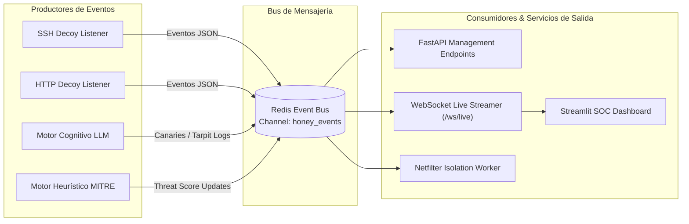

# **Honey-Agent: Especificación de API y Modelos de Datos**

* **Documento:** API & Data Contract Specification
* **Código de Documento:** HA-API-06
* **Versión:** 1.0.0
* **Estado:** Aprobado para Implementación
* **Clasificación:** Confidencial / Interfaces de Integración de Software

---

## **1. Alcance y Arquitectura de Comunicaciones**

El ecosistema de Honey-Agent expone una arquitectura de interfaces dividida en tres canales de comunicación:

1. **REST API (Gestión y Control):** Endpoints HTTP autenticados para consulta de telemetría forense, administración de sesiones y órdenes de mitigación manual desde consolas SOC.
2. **WebSocket / SSE (Streaming en Tiempo Real):** Canal dúplex de baja latencia para retransmitir las pulsaciones de teclas y salidas del terminal virtual directamente hacia el dashboard interactivo de Streamlit.
3. **Bus de Eventos Interno (Redis Pub/Sub):** Desacoplamiento asíncrono entre el listener SSH/HTTP, el motor generativo LLM y el subsistema de contención perimetral.



---

## **2. Modelos de Datos de Eventos (Pydantic / JSON Schemas)**

Todos los eventos que circulan por el bus son serializados en formato JSON estricto derivado de los siguientes esquemas tipados:

### **2.1. Evento de Inicio de Sesión (`SessionStartEvent`)**

```json
{
  "$schema": "https://json-schema.org/draft/2020-12/schema",
  "title": "SessionStartEvent",
  "type": "object",
  "properties": {
    "event_id": { "type": "string", "format": "uuid" },
    "event_type": { "type": "string", "const": "SESSION_STARTED" },
    "timestamp": { "type": "string", "format": "date-time" },
    "session_id": { "type": "string" },
    "protocol": { "type": "string", "enum": ["SSH", "HTTP"] },
    "attacker_ip": { "type": "string", "format": "ipv4" },
    "attacker_port": { "type": "integer" },
    "credentials_used": {
      "type": "object",
      "properties": {
        "username": { "type": "string" },
        "password": { "type": "string" },
        "auth_type": { "type": "string", "enum": ["PASSWORD", "PUBLIC_KEY"] }
      },
      "required": ["username", "auth_type"]
    },
    "client_banner": { "type": "string" },
    "geolocation": {
      "type": "object",
      "properties": {
        "country": { "type": "string" },
        "city": { "type": "string" },
        "asn": { "type": "string" }
      }
    }
  },
  "required": ["event_id", "event_type", "timestamp", "session_id", "protocol", "attacker_ip"]
}
```

### **2.2. Evento de Ejecución de Comando (`CommandExecutedEvent`)**

```json
{
  "event_id": "evt-7f8e9d-1122",
  "event_type": "COMMAND_EXECUTED",
  "timestamp": "2026-10-31T04:15:28.450Z",
  "session_id": "sess-ubuntu-4481",
  "attacker_ip": "192.168.1.100",
  "command": "cat /var/www/html/.env",
  "working_directory": "/var/www/html",
  "user": "root",
  "stdout_snippet": "DB_HOST=10.0.4.15\nDB_USER=app_admin...",
  "exit_code": 0,
  "mitre_classification": {
    "technique_id": "T1552.001",
    "tactic": "Credential Access",
    "technique_name": "Credentials in Files",
    "confidence": 0.98
  },
  "tarpit_metrics": {
    "base_delay_ms": 800,
    "fatigue_delay_ms": 420,
    "jitter_ms": 115,
    "total_wait_ms": 1335
  },
  "threat_score_after_cmd": 55.0
}
```

### **2.3. Evento de Inoculación de Canary Token (`CanaryGeneratedEvent`)**

```json
{
  "event_id": "canary-evt-9901",
  "event_type": "CANARY_INJECTED",
  "timestamp": "2026-10-31T04:15:29.800Z",
  "session_id": "sess-ubuntu-4481",
  "attacker_ip": "192.168.1.100",
  "token_type": "AWS_ACCESS_KEY",
  "token_public_id": "AKIAIOSFODNN7CANARYTK",
  "token_signature_hmac": "98a76fbc54d3e210",
  "target_file": "/var/www/html/.env",
  "alert_destination": "SIEM_WEBHOOK_CLOUD_TRAIL"
}
```

### **2.4. Evento de Cuarentena y Aislamiento (`ContainmentTriggeredEvent`)**

```json
{
  "event_id": "iso-evt-0012",
  "event_type": "CONTAINMENT_TRIGGERED",
  "timestamp": "2026-10-31T04:16:02.100Z",
  "session_id": "sess-ubuntu-4481",
  "attacker_ip": "192.168.1.100",
  "trigger_reason": "CRITICAL_TECHNIQUE_DETECTED: T1059.001 (Pipe Bash Remote Execution)",
  "final_threat_score": 100.0,
  "mitigation_action": "NETFILTER_IPTABLES_DROP",
  "kernel_command": "/usr/sbin/iptables -I INPUT -s 192.168.1.100 -j DROP",
  "execution_duration_ms": 3.8,
  "status": "CONTAINED_AND_BLOCKED"
}
```

---

## **3. Especificación de Endpoints REST (FastAPI / OpenAPI 3.1)**

Los servicios de gestión se encuentran disponibles bajo el prefijo `/api/v1`:

### **3.1. Listar Sesiones Activas e Históricas**
* **Endpoint:** `GET /api/v1/sessions`
* **Query Parameters:**
  * `status` (string, opcional): `ACTIVE`, `CONTAINED`, `CLOSED`.
  * `min_threat_score` (float, opcional): Filtrar sesiones por peligrosidad.
  * `limit` (int, default: 50): Número de registros a retornar.
* **Respuesta Exitosa (200 OK):**
```json
[
  {
    "session_id": "sess-ubuntu-4481",
    "protocol": "SSH",
    "attacker_ip": "192.168.1.100",
    "country": "ES",
    "started_at": "2026-10-31T04:14:50Z",
    "status": "CONTAINED",
    "threat_score": 100.0,
    "total_commands": 8,
    "canaries_inoculated": 2,
    "dwell_time_seconds": 72.1
  }
]
```

### **3.2. Detalle Forense de Sesión**
* **Endpoint:** `GET /api/v1/sessions/{session_id}`
* **Respuesta Exitosa (200 OK):**
Retorna la cronología completa de comandos, salida generada, tiempos de respuesta de Tarpit y tokens entregados al intruso.

### **3.3. Forzar Aislamiento Manual de IP (SOC Override)**
* **Endpoint:** `POST /api/v1/containment/isolate`
* **Request Body:**
```json
{
  "ip_address": "192.168.1.100",
  "reason": "SOC Analyst Manual Emergency Quarantine",
  "duration_seconds": 86400
}
```
* **Respuesta (200 OK):**
```json
{
  "status": "SUCCESS",
  "ip_address": "192.168.1.100",
  "action_executed": "iptables -I INPUT -s 192.168.1.100 -j DROP",
  "quarantine_until": "2026-11-01T04:16:00Z"
}
```

### **3.4. Desbloquear IP de Lista Negra**
* **Endpoint:** `DELETE /api/v1/containment/isolate/{ip_address}`
* **Respuesta (200 OK):**
```json
{
  "status": "UNBLOCKED",
  "ip_address": "192.168.1.100",
  "message": "Netfilter drop rule removed successfully."
}
```

### **3.5. Inventario de Canary Tokens Emitidos**
* **Endpoint:** `GET /api/v1/canaries`
* **Respuesta (200 OK):**
Retorna la base de datos de credenciales falsas inoculadas en atacantes, permitiendo verificar al instante si una credencial detectada en logs de AWS o VPN pertenece a Honey-Agent.

---

## **4. Protocolo WebSocket de Streaming en Vivo (`/ws/live`)**

Para alimentar la visualización de terminal en el dashboard de Streamlit, Honey-Agent expone un endpoint WebSocket dúplex:

* **URL de Conexión:** `ws://127.0.0.1:8000/ws/live`
* **Mensaje de Suscripción del Cliente:**
```json
{
  "action": "SUBSCRIBE_SESSION",
  "session_id": "sess-ubuntu-4481"
}
```

* **Flujo de Tramas Emitidas hacia el Dashboard (Server Push):**
```json
{
  "stream_type": "TERMINAL_FEED",
  "session_id": "sess-ubuntu-4481",
  "data": {
    "type": "STDOUT_CHUNK",
    "text": "root@prod-srv-01:~# ",
    "threat_score": 15.0,
    "last_mitre_id": "T1082"
  }
}
```

Este protocolo permite que el jurado o los analistas del SOC observen las acciones del atacante carácter por carácter con latencia menor a 50 milisegundos.

