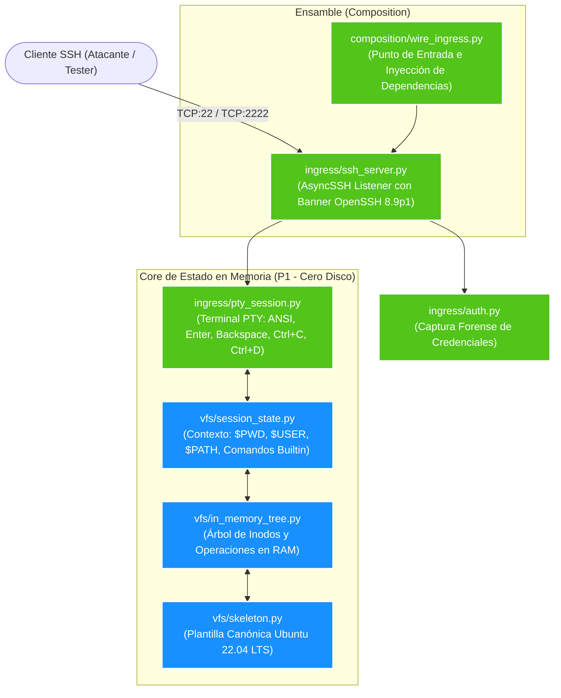

# **Honey-Agent: Guía de Construcción - Parte 1 (Ingress y VFS en Memoria)**

* **Documento:** Technical Implementation Blueprint - Phase 1 (Ingress & In-Memory State Engine)
* **Código de Documento:** HA-SPEC-11
* **Versión:** 1.0.0
* **Estado:** Aprobado para Codificación Inmediata
* **Responsable / Rol:** Programador 1 (**P1 — Ingress y VFS**)
* **Clasificación:** Confidencial / Manual de Implementación de Software

---

## **1. Alcance y Criterio de Cierre de la Parte 1**

El propósito exclusivo de la **Parte 1** es construir y validar los cimientos de red y la persistencia volátil del señuelo:

> **Criterio de Cierre (DoD - Definition of Done):**
> Un cliente SSH se conecta de forma remota, recibe el prompt `root@prod-srv-app01:~#`, los comandos de navegación y archivos (`pwd`, `cd`, `echo`, `cat`, `mkdir`, `ls`) persisten durante la vida de la sesión, dos sesiones concurrentes están 100% aisladas entre sí, y **el sistema operativo host no escribe ningún byte en su disco físico**.



---

## **2. Regla de Arquitectura y Aislamiento de Paquetes**

De acuerdo con el acuerdo de arquitectura de [HA-TEAM-10](10_Reparto_de_Trabajo_4_Programadores.md):
* **P1 es dueño absoluto de:**
  * `src/honey_agent/ingress/`
  * `src/honey_agent/vfs/`
  * `src/honey_agent/composition/wire_ingress.py`
  * `tests/ingress/`, `tests/vfs/`, `tests/fakes/filesystem.py`
* **Regla de Imports:** Los paquetes de `ingress` y `vfs` **NO importan** los paquetes de otros programadores (`posix`, `tarpit`, `canary`, `defense`). Solo importan la biblioteca estándar, `asyncssh`, `pydantic` y los contratos base.

---

## **3. Estructura de Archivos a Crear**

```text
C:\Security_IA\
├── src\
│   └── honey_agent\
│       ├── __init__.py
│       ├── ingress\
│       │   ├── __init__.py
│       │   ├── auth.py              # Política de autenticación y captura de credenciales
│       │   ├── pty_session.py       # Terminal virtual PTY: ANSI, CRLF, backspace, señales
│       │   └── ssh_server.py        # Demonio AsyncSSH y despachador de conexiones
│       ├── vfs\
│       │   ├── __init__.py
│       │   ├── in_memory_tree.py    # Árbol jerárquico de inodos en RAM
│       │   ├── skeleton.py          # Plantilla del sistema de archivos Ubuntu 22.04 LTS
│       │   └── session_state.py     # Estado de sesión ($PWD, $USER) y comandos builtin
│       └── composition\
│           ├── __init__.py
│           └── wire_ingress.py      # Script ejecutable de arranque para la Parte 1
└── tests\
    ├── __init__.py
    ├── fakes\
    │   ├── __init__.py
    │   └── filesystem.py            # Fixtures y fakes de prueba para el VFS
    ├── ingress\
    │   ├── __init__.py
    │   └── test_ssh_pty.py          # Tests E2E de conexión SSH y emulación de terminal
    └── vfs\
        ├── __init__.py
        └── test_in_memory_tree.py   # Tests unitarios del árbol VFS y comandos builtin
```

---

## **4. Especificación Técnica de Código Archivo por Archivo**

### **4.1. `src/honey_agent/vfs/in_memory_tree.py`**
Implementa el sistema de inodos y árbol de directorios en memoria volátil. No ejecuta ninguna llamada de sistema nativa (`open`, `os.mkdir`, `shutil`), eliminando por diseño cualquier riesgo de fuga o persistencia física.

```python
"""
src/honey_agent/vfs/in_memory_tree.py
Dueño: Programador 1 (P1).
Responsabilidad: Árbol de inodos en RAM (Zero-Disk) y operaciones atómicas de archivos.
"""

from __future__ import annotations
import copy
import time
from typing import Dict, List, Optional, Tuple

class VFSNode:
    """Representación en memoria de un inodo (archivo o directorio)."""

    def __init__(
        self,
        name: str,
        is_dir: bool = False,
        owner: str = "root",
        group: str = "root",
        permissions: int = 0o755,
        content: bytes = b"",
    ):
        self.name = name
        self.is_dir = is_dir
        self.owner = owner
        self.group = group
        self.permissions = permissions
        self.content = content
        self.mtime = time.time()
        self.ctime = self.mtime
        self.children: Dict[str, VFSNode] = {} if is_dir else {}

    @property
    def size(self) -> int:
        return 4096 if self.is_dir else len(self.content)

class VirtualFileSystem:
    """Sistema de Archivos Virtual que opera exclusivamente en RAM."""

    def __init__(self):
        self.root = VFSNode(name="", is_dir=True)

    def normalize_path(self, path: str, cwd: str = "/") -> str:
        """Convierte cualquier ruta relativa o con . / .. en ruta canónica absoluta."""
        if not path.startswith("/"):
            path = f"{cwd.rstrip('/')}/{path}"

        segments = path.split("/")
        resolved: List[str] = []
        for seg in segments:
            if not seg or seg == ".":
                continue
            if seg == "..":
                if resolved:
                    resolved.pop()
            else:
                resolved.append(seg)
        return "/" + "/".join(resolved)

    def get_node(self, canonical_path: str) -> Optional[VFSNode]:
        """Recupera el nodo asociado a una ruta canónica."""
        if canonical_path == "/":
            return self.root

        parts = [p for p in canonical_path.split("/") if p]
        curr = self.root
        for part in parts:
            if not curr.is_dir or part not in curr.children:
                return None
            curr = curr.children[part]
        return curr

    def mkdir(self, canonical_path: str, permissions: int = 0o755) -> bool:
        """Crea un directorio y sus ancestros de forma recursiva."""
        parts = [p for p in canonical_path.split("/") if p]
        curr = self.root
        for part in parts:
            if part not in curr.children:
                new_dir = VFSNode(name=part, is_dir=True, permissions=permissions)
                curr.children[part] = new_dir
                curr = new_dir
            else:
                curr = curr.children[part]
                if not curr.is_dir:
                    return False
        return True

    def write_file(self, canonical_path: str, content: bytes, permissions: int = 0o644) -> bool:
        """Escribe datos en un archivo en RAM (crea directorios padres si no existen)."""
        parts = [p for p in canonical_path.split("/") if p]
        if not parts:
            return False

        parent_path = "/" + "/".join(parts[:-1]) if len(parts) > 1 else "/"
        filename = parts[-1]

        parent_node = self.get_node(parent_path)
        if not parent_node or not parent_node.is_dir:
            if not self.mkdir(parent_path):
                return False
            parent_node = self.get_node(parent_path)

        if filename in parent_node.children:
            existing = parent_node.children[filename]
            if existing.is_dir:
                return False
            existing.content = content
            existing.mtime = time.time()
        else:
            parent_node.children[filename] = VFSNode(
                name=filename, is_dir=False, permissions=permissions, content=content
            )
        return True

    def read_file(self, canonical_path: str) -> Optional[bytes]:
        """Retorna el contenido de un archivo o None si no existe o es directorio."""
        node = self.get_node(canonical_path)
        if not node or node.is_dir:
            return None
        return node.content

    def listdir(self, canonical_path: str) -> Optional[List[Tuple[str, VFSNode]]]:
        """Retorna las entradas hijas de un directorio ordenadas alfabéticamente."""
        node = self.get_node(canonical_path)
        if not node or not node.is_dir:
            return None
        return sorted(node.children.items(), key=lambda x: x[0])

    def unlink(self, canonical_path: str) -> bool:
        """Elimina un archivo o directorio vacío."""
        if canonical_path == "/":
            return False
        parts = [p for p in canonical_path.split("/") if p]
        parent_path = "/" + "/".join(parts[:-1]) if len(parts) > 1 else "/"
        filename = parts[-1]

        parent = self.get_node(parent_path)
        if parent and parent.is_dir and filename in parent.children:
            del parent.children[filename]
            return True
        return False

    def clone(self) -> "VirtualFileSystem":
        """Clona el VFS completo para dotar a una nueva sesión de aislamiento absoluto."""
        return copy.deepcopy(self)
```

---

### **4.2. `src/honey_agent/vfs/skeleton.py`**
Inicializa la estructura canónica de archivos de un sistema operativo Ubuntu 22.04 LTS real para convencer a escáneres y operadores manuales.

```python
"""
src/honey_agent/vfs/skeleton.py
Dueño: Programador 1 (P1).
Responsabilidad: Poblar el VFS inicial con archivos idénticos a Ubuntu 22.04 LTS.
"""

from honey_agent.vfs.in_memory_tree import VirtualFileSystem

def populate_ubuntu_skeleton(vfs: VirtualFileSystem):
    """Puebla el árbol VFS en RAM con el esqueleto del sistema operativo."""
    # 1. Directorios base de la jerarquía FHS (Filesystem Hierarchy Standard)
    standard_dirs = [
        "/bin", "/boot", "/dev", "/etc", "/home", "/lib", "/lib64", 
        "/media", "/mnt", "/opt", "/proc", "/root", "/run", "/sbin", 
        "/srv", "/sys", "/tmp", "/usr", "/usr/bin", "/usr/sbin", 
        "/var", "/var/www", "/var/www/html", "/var/log", "/etc/ssh", 
        "/home/ubuntu", "/root/.ssh"
    ]
    for d in standard_dirs:
        vfs.mkdir(d)

    # 2. Información del sistema operativo (/etc/os-release)
    vfs.write_file(
        "/etc/os-release",
        (
            'NAME="Ubuntu"\n'
            'VERSION="22.04.4 LTS (Jammy Jellyfish)"\n'
            'ID=ubuntu\n'
            'ID_LIKE=debian\n'
            'PRETTY_NAME="Ubuntu 22.04.4 LTS"\n'
            'VERSION_ID="22.04"\n'
            'HOME_URL="https://www.ubuntu.com/"\n'
            'SUPPORT_URL="https://help.ubuntu.com/"\n'
            'BUG_REPORT_URL="https://bugs.launchpad.net/ubuntu/"\n'
            'PRIVACY_POLICY_URL="https://www.ubuntu.com/legal/terms-and-policies/privacy-policy"\n'
            'UBUNTU_CODENAME=jammy\n'
        ).encode("utf-8")
    )

    # 3. Hostname y red
    vfs.write_file("/etc/hostname", b"prod-srv-app01\n")
    vfs.write_file(
        "/etc/hosts",
        (
            "127.0.0.1 localhost\n"
            "127.0.1.1 prod-srv-app01\n"
            "# The following lines are desirable for IPv6 capable hosts\n"
            "::1 ip6-localhost ip6-loopback\n"
            "fe00::0 ip6-localnet\n"
            "ff00::0 ip6-mcastprefix\n"
            "ff02::1 ip6-allnodes\n"
            "ff02::2 ip6-allrouters\n"
        ).encode("utf-8")
    )
    vfs.write_file(
        "/etc/resolv.conf",
        (
            "# This file is managed by man:systemd-resolved(8).\n"
            "nameserver 127.0.0.53\n"
            "options edns0 trust-ad\n"
            "search corp.internal\n"
        ).encode("utf-8")
    )

    # 4. Cuentas de usuario (/etc/passwd)
    vfs.write_file(
        "/etc/passwd",
        (
            "root:x:0:0:root:/root:/bin/bash\n"
            "daemon:x:1:1:daemon:/usr/sbin:/usr/sbin/nologin\n"
            "bin:x:2:2:bin:/bin:/usr/sbin/nologin\n"
            "sys:x:3:3:sys:/dev:/usr/sbin/nologin\n"
            "sync:x:4:65534:sync:/bin:/bin/sync\n"
            "games:x:5:60:games:/usr/games:/usr/sbin/nologin\n"
            "man:x:6:12:man:/var/cache/man:/usr/sbin/nologin\n"
            "lp:x:7:7:lp:/var/spool/lpd:/usr/sbin/nologin\n"
            "mail:x:8:8:mail:/var/mail:/usr/sbin/nologin\n"
            "news:x:9:9:news:/var/spool/news:/usr/sbin/nologin\n"
            "uucp:x:10:10:uucp:/var/spool/uucp:/usr/sbin/nologin\n"
            "proxy:x:13:13:proxy:/bin:/usr/sbin/nologin\n"
            "www-data:x:33:33:www-data:/var/www:/usr/sbin/nologin\n"
            "backup:x:34:34:backup:/var/backups:/usr/sbin/nologin\n"
            "list:x:38:38:Mailing List Manager:/var/list:/usr/sbin/nologin\n"
            "irc:x:39:39:ircd:/run/ircd:/usr/sbin/nologin\n"
            "nobody:x:65534:65534:nobody:/nonexistent:/usr/sbin/nologin\n"
            "systemd-network:x:100:102:systemd Network Management,,,:/run/systemd:/usr/sbin/nologin\n"
            "systemd-resolve:x:101:103:systemd Resolver,,,:/run/systemd:/usr/sbin/nologin\n"
            "messagebus:x:102:105::/nonexistent:/usr/sbin/nologin\n"
            "sshd:x:121:65534::/run/sshd:/usr/sbin/nologin\n"
            "ubuntu:x:1000:1000:Ubuntu:/home/ubuntu:/bin/bash\n"
        ).encode("utf-8")
    )

    # 5. Entorno /proc simulado
    vfs.write_file(
        "/proc/version",
        b"Linux version 5.15.0-101-generic (buildd@lcy02-amd64-022) (gcc 11.4.0) #111-Ubuntu SMP Tue Mar 5 20:16:58 UTC 2024\n"
    )
    vfs.write_file(
        "/proc/cpuinfo",
        (
            "processor\t: 0\n"
            "vendor_id\t: GenuineIntel\n"
            "cpu family\t: 6\n"
            "model\t\t: 158\n"
            "model name\t: Intel(R) Xeon(R) Platinum 8275CL CPU @ 3.00GHz\n"
            "stepping\t: 7\n"
            "cpu MHz\t\t: 2999.998\n"
            "cache size\t: 36608 KB\n"
        ).encode("utf-8")
    )

    # 6. Servicio Web falso
    vfs.write_file(
        "/var/www/html/index.nginx-debian.html",
        (
            "<!DOCTYPE html>\n"
            "<html>\n"
            "<head>\n"
            "<title>Welcome to nginx!</title>\n"
            "<style>body { width: 35em; margin: 0 auto; font-family: Tahoma, Verdana, Arial, sans-serif; }</style>\n"
            "</head>\n"
            "<body>\n"
            "<h1>Welcome to nginx!</h1>\n"
            "<p>If you see this page, the nginx web server is successfully installed and working.</p>\n"
            "</body>\n"
            "</html>\n"
        ).encode("utf-8")
    )
```

---

### **4.3. `src/honey_agent/vfs/session_state.py`**
Mantiene el contexto temporal de la terminal (`$PWD`, variables de entorno, buffer de historial) y gestiona los comandos internos builtin para operar el VFS sin depender de shells nativas ni del LLM.

```python
"""
src/honey_agent/vfs/session_state.py
Dueño: Programador 1 (P1).
Responsabilidad: Estado mutable de sesión ($PWD, variables) y builtins de la Parte 1.
"""

from typing import Dict, List, Tuple
from honey_agent.vfs.in_memory_tree import VirtualFileSystem

class SessionState:
    """Mantiene el estado y variables de una sesión interactiva."""

    def __init__(self, vfs: VirtualFileSystem, username: str = "root"):
        self.vfs = vfs
        self.username = username
        self.hostname = "prod-srv-app01"
        self.cwd = "/root" if username == "root" else f"/home/{username}"
        self.env: Dict[str, str] = {
            "USER": username,
            "HOME": self.cwd,
            "PWD": self.cwd,
            "PATH": "/usr/local/sbin:/usr/local/bin:/usr/sbin:/usr/bin:/sbin:/bin",
            "SHELL": "/bin/bash",
            "HOSTNAME": self.hostname,
            "TERM": "xterm-256color",
            "SHLVL": "1",
        }
        self.command_history: List[str] = []

    def get_prompt(self) -> str:
        """Retorna el prompt de bash: root@prod-srv-app01:~# o user@prod-srv-app01:~$ """
        symbol = "#" if self.username == "root" else "$"
        display_cwd = "~" if self.cwd == self.env.get("HOME") else self.cwd
        return f"{self.username}@{self.hostname}:{display_cwd}{symbol} "

    def execute_builtin(self, cmd_line: str) -> Tuple[bool, str, str, int]:
        """
        Ejecuta comandos builtin directos de la Parte 1.
        Retorna: (is_handled, stdout, stderr, exit_code)
        """
        raw = cmd_line.strip()
        if not raw:
            return True, "", "", 0

        self.command_history.append(raw)
        tokens = raw.split()
        cmd = tokens[0]
        args = tokens[1:]

        if cmd == "pwd":
            return True, f"{self.cwd}\n", "", 0

        elif cmd == "cd":
            target = args[0] if args else self.env.get("HOME", "/root")
            new_path = self.vfs.normalize_path(target, self.cwd)
            node = self.vfs.get_node(new_path)
            if not node:
                return True, "", f"bash: cd: {target}: No such file or directory\n", 1
            if not node.is_dir:
                return True, "", f"bash: cd: {target}: Not a directory\n", 1
            self.cwd = new_path
            self.env["PWD"] = self.cwd
            return True, "", "", 0

        elif cmd == "ls":
            show_all = any(arg in ("-a", "-la", "-al") for arg in args)
            show_long = any(arg in ("-l", "-la", "-al") for arg in args)
            target = next((a for a in args if not a.startswith("-")), ".")
            norm_path = self.vfs.normalize_path(target, self.cwd)
            node = self.vfs.get_node(norm_path)

            if not node:
                return True, "", f"ls: cannot access '{target}': No such file or directory\n", 2
            if not node.is_dir:
                return True, f"{node.name}\n", "", 0

            entries = self.vfs.listdir(norm_path) or []
            if show_long:
                lines = [f"total {len(entries) * 4}"]
                if show_all:
                    lines.append(f"drwxr-xr-x 2 {node.owner} {node.group} 4096 Oct 31 04:00 .")
                    lines.append(f"drwxr-xr-x 2 {node.owner} {node.group} 4096 Oct 31 04:00 ..")
                for name, child in entries:
                    if name.startswith(".") and not show_all:
                        continue
                    prefix = "d" if child.is_dir else "-"
                    perm = "rwxr-xr-x" if child.is_dir else "rw-r--r--"
                    lines.append(
                        f"{prefix}{perm} 1 {child.owner} {child.group} {child.size:>6} Oct 31 04:00 {name}"
                    )
                return True, "\n".join(lines) + "\n", "", 0
            else:
                names = [".", ".."] if show_all else []
                for name, _ in entries:
                    if name.startswith(".") and not show_all:
                        continue
                    names.append(name)
                return True, "  ".join(names) + ("\n" if names else ""), "", 0

        elif cmd == "cat":
            if not args:
                return True, "", "", 0
            out, err = [], []
            for f in args:
                p = self.vfs.normalize_path(f, self.cwd)
                content = self.vfs.read_file(p)
                if content is None:
                    node = self.vfs.get_node(p)
                    if node and node.is_dir:
                        err.append(f"cat: {f}: Is a directory\n")
                    else:
                        err.append(f"cat: {f}: No such file or directory\n")
                else:
                    out.append(content.decode("utf-8", errors="replace"))
            return True, "".join(out), "".join(err), (1 if err else 0)

        elif cmd == "echo":
            joined = " ".join(args)
            if ">" in joined:
                parts = joined.split(">", 1)
                text = parts[0].strip().strip('"').strip("'") + "\n"
                dest_path = self.vfs.normalize_path(parts[1].strip(), self.cwd)
                self.vfs.write_file(dest_path, text.encode("utf-8"))
                return True, "", "", 0
            clean = joined.strip('"').strip("'") + "\n"
            return True, clean, "", 0

        elif cmd == "touch":
            for f in args:
                p = self.vfs.normalize_path(f, self.cwd)
                if not self.vfs.get_node(p):
                    self.vfs.write_file(p, b"")
            return True, "", "", 0

        elif cmd == "mkdir":
            for d in args:
                p = self.vfs.normalize_path(d, self.cwd)
                self.vfs.mkdir(p)
            return True, "", "", 0

        elif cmd == "whoami":
            return True, f"{self.username}\n", "", 0

        elif cmd == "id":
            uid = 0 if self.username == "root" else 1000
            return True, f"uid={uid}({self.username}) gid={uid}({self.username}) groups={uid}({self.username})\n", "", 0

        elif cmd == "exit":
            return True, "logout\n", "", 0

        # No es builtin: en la Parte 2 se derivará al LLM
        return False, "", "", 0
```

---

### **4.4. `src/honey_agent/ingress/auth.py`**
Captura y registra cada intento de autenticación SSH para perfilado forense del atacante.

```python
"""
src/honey_agent/ingress/auth.py
Dueño: Programador 1 (P1).
Responsabilidad: Captura y auditoría de credenciales del atacante.
"""

import logging
from dataclasses import dataclass
from typing import Optional

logger = logging.getLogger("HoneyAgent.Auth")

@dataclass
class CapturedCredentials:
    ip: str
    port: int
    username: str
    password: Optional[str] = None
    auth_type: str = "password"

class HoneyAuthHandler:
    """Gestiona la política permisiva de autenticación de Honey-Agent."""

    def __init__(self):
        self.captured_log = []

    def authenticate_password(self, ip: str, port: int, username: str, password: str) -> bool:
        """Registra las credenciales enviadas y siempre retorna True (permisivo)."""
        record = CapturedCredentials(
            ip=ip, port=port, username=username, password=password, auth_type="password"
        )
        self.captured_log.append(record)
        logger.warning(
            f"[CREDENCIAL CAPTURADA] Host: {ip}:{port} | User: '{username}' | Pass: '{password}'"
        )
        return True
```

---

### **4.5. `src/honey_agent/ingress/pty_session.py`**
Implementa el flujo interactivo de la terminal VT100/ANSI, procesando caracteres individuales en modo crudo (*raw*), ecos, borrados y señales.

```python
"""
src/honey_agent/ingress/pty_session.py
Dueño: Programador 1 (P1).
Responsabilidad: Terminal PTY virtual: ANSI, CRLF, backspace, Ctrl+C y Ctrl+D.
"""

import asyncssh
from typing import Optional
from honey_agent.vfs.session_state import SessionState

class HoneyPTYSession(asyncssh.SSHServerSession):
    """Maneja el canal PTY interactivo entre el atacante y el SessionState."""

    def __init__(self, session_state: SessionState):
        self.state = session_state
        self._chan: Optional[asyncssh.SSHServerChannel] = None
        self._input_buffer: str = ""

    def connection_made(self, chan: asyncssh.SSHServerChannel):
        self._chan = chan

    def pty_requested(self, term_type: str, term_size: tuple, term_modes: dict) -> bool:
        return True

    def shell_requested(self) -> bool:
        return True

    def session_started(self):
        """Emite el prompt inicial al abrir la terminal."""
        prompt = self.state.get_prompt()
        self._chan.write(prompt)

    def data_received(self, data: str, datatype: asyncssh.DataType):
        """Procesa caracteres entrantes con emulación de terminal VT100."""
        for char in data:
            # 1. Enter (\r o \n)
            if char in ("\r", "\n"):
                self._chan.write("\r\n")
                cmd = self._input_buffer
                self._input_buffer = ""

                handled, stdout, stderr, code = self.state.execute_builtin(cmd)
                if not handled:
                    cmd_first = cmd.split()[0] if cmd.split() else ""
                    self._chan.write(f"bash: {cmd_first}: command not found\r\n")
                else:
                    if stdout:
                        self._chan.write(stdout.replace("\n", "\r\n"))
                    if stderr:
                        self._chan.write(stderr.replace("\n", "\r\n"))

                if cmd.strip() == "exit":
                    self._chan.exit(code)
                    self._chan.close()
                    return

                self._chan.write(self.state.get_prompt())

            # 2. Backspace (\x08 o \x7f)
            elif char in ("\x08", "\x7f"):
                if len(self._input_buffer) > 0:
                    self._input_buffer = self._input_buffer[:-1]
                    self._chan.write("\b \b")

            # 3. Ctrl+C (\x03)
            elif char == "\x03":
                self._input_buffer = ""
                self._chan.write("^C\r\n")
                self._chan.write(self.state.get_prompt())

            # 4. Ctrl+D (\x04)
            elif char == "\x04":
                if not self._input_buffer:
                    self._chan.write("logout\r\n")
                    self._chan.exit(0)
                    self._chan.close()
                    return

            # 5. Caracteres imprimibles estándar
            elif ord(char) >= 32:
                self._input_buffer += char
                self._chan.write(char) # Eco local de terminal
```

---

### **4.6. `src/honey_agent/ingress/ssh_server.py`**
Subclase de `asyncssh.SSHServer` que orquesta la autenticación, asocia a cada atacante un `VirtualFileSystem` clonado e independiente, e instancia la sesión PTY.

```python
"""
src/honey_agent/ingress/ssh_server.py
Dueño: Programador 1 (P1).
Responsabilidad: Servidor AsyncSSH, banner OpenSSH 8.9p1 y aislamiento multi-tenant.
"""

import asyncssh
import logging
from honey_agent.vfs.in_memory_tree import VirtualFileSystem
from honey_agent.vfs.session_state import SessionState
from honey_agent.ingress.auth import HoneyAuthHandler
from honey_agent.ingress.pty_session import HoneyPTYSession

logger = logging.getLogger("HoneyAgent.SSHServer")

class HoneySSHServer(asyncssh.SSHServer):
    """Implementa el servidor SSH señuelo sobre AsyncSSH."""

    def __init__(self, master_vfs: VirtualFileSystem, auth_handler: HoneyAuthHandler):
        self.master_vfs = master_vfs
        self.auth_handler = auth_handler
        self.client_ip = "127.0.0.1"
        self.client_port = 0
        self.username = "root"

    def connection_made(self, conn: asyncssh.SSHServerConnection):
        peer = conn.get_extra_info("peername")
        if peer:
            self.client_ip, self.client_port = peer[0], peer[1]
        logger.info(f"[TCP INGRESS] Conexion establecida desde {self.client_ip}:{self.client_port}")

    def begin_auth(self, username: str) -> bool:
        self.username = username or "root"
        return True

    def password_auth_requested(self, username: str, password: str) -> bool:
        return self.auth_handler.authenticate_password(
            ip=self.client_ip, port=self.client_port, username=username, password=password
        )

    def session_requested(self) -> asyncssh.SSHServerSession:
        """Crea una sesión con VFS clonado en RAM e independiente para cada atacante."""
        isolated_vfs = self.master_vfs.clone()
        session_state = SessionState(vfs=isolated_vfs, username=self.username)
        return HoneyPTYSession(session_state)
```

---

### **4.7. `src/honey_agent/composition/wire_ingress.py`**
Punto de ensamble ejecutable para levantar la Parte 1 de forma autónoma.

```python
"""
src/honey_agent/composition/wire_ingress.py
Dueño: Programador 1 (P1).
Responsabilidad: Ensamble y arranque del servidor SSH con VFS en RAM para la Parte 1.
"""

import asyncio
import logging
import asyncssh
from honey_agent.vfs.in_memory_tree import VirtualFileSystem
from honey_agent.vfs.skeleton import populate_ubuntu_skeleton
from honey_agent.ingress.auth import HoneyAuthHandler
from honey_agent.ingress.ssh_server import HoneySSHServer

logging.basicConfig(
    level=logging.INFO,
    format="%(asctime)s [%(levelname)s] %(name)s: %(message)s"
)
logger = logging.getLogger("HoneyAgent.WireIngress")

async def start_ingress(port: int = 2222):
    """Inicializa el VFS maestro y arranca el listener SSH."""
    # 1. Crear e inicializar VFS maestro con plantilla Ubuntu
    master_vfs = VirtualFileSystem()
    populate_ubuntu_skeleton(master_vfs)
    logger.info("VFS Maestro en RAM inicializado con plantilla canónica Ubuntu 22.04 LTS.")

    # 2. Inicializar manejador de autenticación
    auth_handler = HoneyAuthHandler()

    # 3. Generar par de claves RSA efímeras para el servidor SSH
    host_key = asyncssh.generate_private_key("ssh-rsa", key_size=2048)

    # 4. Crear y bindear el servidor AsyncSSH
    server = await asyncssh.create_server(
        lambda: HoneySSHServer(master_vfs=master_vfs, auth_handler=auth_handler),
        host="0.0.0.0",
        port=port,
        server_host_keys=[host_key],
        server_version="OpenSSH_8.9p1 Ubuntu-3ubuntu0.4",
        encoding="utf-8"
    )

    logger.info(f"===> [HONEY-AGENT PARTE 1 ACTIVO] <===")
    logger.info(f"Escuchando en 0.0.0.0:{port} | Banner: OpenSSH_8.9p1 Ubuntu-3ubuntu0.4")
    logger.info(f"Para probar: ssh root@127.0.0.1 -p {port}")
    await server.wait_closed()

if __name__ == "__main__":
    try:
        asyncio.run(start_ingress(port=2222))
    except (KeyboardInterrupt, SystemExit):
        logger.info("Servidor detenido manualmente.")
```

---

## **5. Pruebas Automatizadas Unitarias y de Integración**

### **5.1. `tests/vfs/test_in_memory_tree.py`**
```python
"""
tests/vfs/test_in_memory_tree.py
Pruebas unitarias de VFS en RAM y SessionState.
"""

import pytest
from honey_agent.vfs.in_memory_tree import VirtualFileSystem
from honey_agent.vfs.skeleton import populate_ubuntu_skeleton
from honey_agent.vfs.session_state import SessionState

@pytest.fixture
def vfs():
    fs = VirtualFileSystem()
    populate_ubuntu_skeleton(fs)
    return fs

@pytest.fixture
def session(vfs):
    return SessionState(vfs, username="root")

def test_ubuntu_skeleton_files_present(vfs):
    assert vfs.read_file("/etc/os-release") is not None
    assert b"Ubuntu 22.04" in vfs.read_file("/etc/os-release")
    assert vfs.read_file("/etc/passwd") is not None
    assert vfs.get_node("/var/www/html").is_dir is True

def test_vfs_write_and_read_isolation(vfs):
    ses_a = vfs.clone()
    ses_b = vfs.clone()

    ses_a.write_file("/tmp/payload.sh", b"#!/bin/bash\necho pwned")
    assert ses_a.read_file("/tmp/payload.sh") == b"#!/bin/bash\necho pwned"
    # Aislamiento: B no puede ver los archivos de A
    assert ses_b.read_file("/tmp/payload.sh") is None

def test_session_navigation_and_builtins(session):
    # pwd
    _, out, _, code = session.execute_builtin("pwd")
    assert code == 0 and out.strip() == "/root"

    # cd /var/www/html
    _, _, _, code = session.execute_builtin("cd /var/www/html")
    assert code == 0 and session.cwd == "/var/www/html"

    # echo a archivo en VFS
    session.execute_builtin("echo 'database_pass=123' > config.env")
    assert session.vfs.read_file("/var/www/html/config.env") == b"database_pass=123\n"

    # cat
    _, out, _, code = session.execute_builtin("cat config.env")
    assert code == 0 and out == "database_pass=123\n"
```

### **5.2. `tests/ingress/test_ssh_pty.py`**
```python
"""
tests/ingress/test_ssh_pty.py
Prueba de integración SSH de extremo a extremo (E2E).
"""

import pytest
import asyncssh
from honey_agent.vfs.in_memory_tree import VirtualFileSystem
from honey_agent.vfs.skeleton import populate_ubuntu_skeleton
from honey_agent.ingress.auth import HoneyAuthHandler
from honey_agent.ingress.ssh_server import HoneySSHServer

@pytest.mark.asyncio
async def test_ssh_connection_and_command_execution():
    master_vfs = VirtualFileSystem()
    populate_ubuntu_skeleton(master_vfs)
    auth = HoneyAuthHandler()
    host_key = asyncssh.generate_private_key("ssh-rsa", key_size=2048)

    server = await asyncssh.create_server(
        lambda: HoneySSHServer(master_vfs=master_vfs, auth_handler=auth),
        host="127.0.0.1",
        port=22224,
        server_host_keys=[host_key],
        encoding="utf-8"
    )

    try:
        async with asyncssh.connect(
            "127.0.0.1",
            port=22224,
            username="test_attacker",
            password="arbitrary_password",
            known_hosts=None
        ) as conn:
            # 1. Ejecutar whoami
            res_who = await conn.run("whoami")
            assert res_who.stdout.strip() == "test_attacker"

            # 2. Ejecutar cat /etc/os-release
            res_cat = await conn.run("cat /etc/os-release")
            assert "Ubuntu" in res_cat.stdout
    finally:
        server.close()
        await server.wait_closed()
```

---

## **6. Guía Rápida de Ejecución y Validación para P1**

```bash
# 1. Activar entorno virtual
cd C:\Security_IA
.\venv\Scripts\Activate.ps1

# 2. Instalar dependencias requeridas
pip install asyncssh cryptography pytest pytest-asyncio pydantic

# 3. Ejecutar las pruebas unitarias y E2E
pytest tests/ -v

# 4. Levantar el servidor en el puerto 2222
python -m honey_agent.composition.wire_ingress

# 5. En una segunda terminal, conectarse via SSH
ssh root@127.0.0.1 -p 2222
# Probar comandos: pwd, ls -la, cd /var/www/html, cat index.nginx-debian.html, echo "demo" > test.txt, cat test.txt, exit
```
