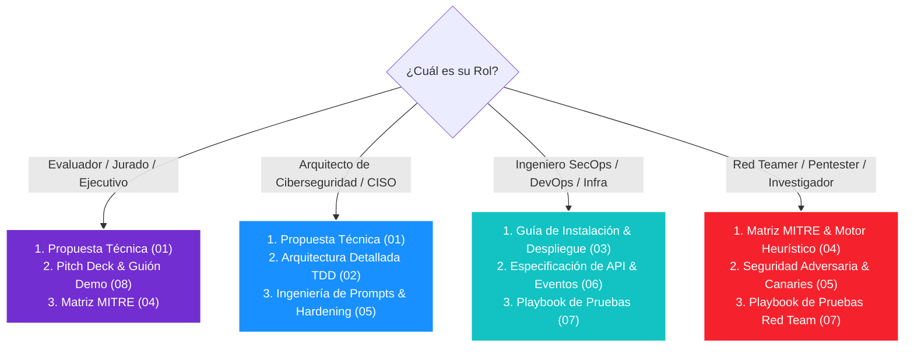

# **Centro Maestro de Documentación Técnica: Honey-Agent**

Bienvenido al centro oficial de documentación del proyecto **Honey-Agent**, el agente defensivo tarpit con contra-inteligencia en memoria y mitigación perimetral autónoma.

Este repositorio documental contiene la especificación completa, arquitectura de sistemas, manuales de despliegue, ingeniería de detección, seguridad adversaria y planes de evaluación del proyecto.

```mermaid
graph TD
    Hub(["Hub de Documentación<br/>docs/README.md"])
    
    Hub --> Doc1["01. Propuesta Técnica y Ejecutiva<br/>(HA-PROP-01)"]
    Hub --> Doc2["02. Arquitectura Técnica & Diseño TDD<br/>(HA-TDD-02)"]
    Hub --> Doc3["03. Guía de Instalación y Despliegue<br/>(HA-OPS-03)"]
    Hub --> Doc4["04. Matriz MITRE & Motor Heurístico<br/>(HA-MITRE-04)"]
    Hub --> Doc5["05. Ingeniería de Prompts & Hardening<br/>(HA-PROMPT-05)"]
    Hub --> Doc6["06. Especificación de API & Modelos<br/>(HA-API-06)"]
    Hub --> Doc7["07. Playbook de Pruebas Red Team<br/>(HA-TEST-07)"]
    Hub --> Doc8["08. Pitch Deck & Guión de Demo<br/>(HA-PITCH-08)"]
    Hub --> Doc9["09. Plan de Implementación en 4 Fases<br/>(HA-DEV-09)"]

    classDef core fill:#1890ff,stroke:#fff,stroke-width:2px,color:#fff;
    class Hub,Doc1,Doc2,Doc3,Doc4,Doc5,Doc6,Doc7,Doc8,Doc9 core;
```

---

## **1. Índice Maestro de Documentos**

| Código | Documento | Enlace | Audiencia Principal | Resumen de Contenido |
| :--- | :--- | :--- | :--- | :--- |
| **HA-PROP-01** | **Propuesta Técnica y Ejecutiva** | [01_Propuesta_Tecnica_Honey_Agent.md](file:///C:/Security_IA/docs/01_Propuesta_Tecnica_Honey_Agent.md) | Jurado, CISOs, Directores de TI | Visión general del proyecto, justificación estratégica, estado del arte y propuesta de valor de ciberdefensa activa. |
| **HA-TDD-02** | **Arquitectura Técnica y Diseño (TDD)** | [02_Arquitectura_Tecnica_y_Diseno_del_Sistema.md](file:///C:/Security_IA/docs/02_Arquitectura_Tecnica_y_Diseno_del_Sistema.md) | Arquitectos de Seguridad, Software Engineers | Descomposición en 8 capas, diseño del VFS en RAM, modelo matemático del Tarpit, diagramas de secuencia y análisis STRIDE. |
| **HA-OPS-03** | **Guía de Instalación, Despliegue y Operación** | [03_Guia_de_Instalacion_Despliegue_y_Operacion.md](file:///C:/Security_IA/docs/03_Guia_de_Instalacion_Despliegue_y_Operacion.md) | DevOps, SysAdmins, SecOps | Requisitos de hardware, reubicación segura del SSH host, despliegue con Docker Compose, systemd y troubleshooting. |
| **HA-MITRE-04** | **Matriz MITRE ATT&CK y Motor Heurístico** | [04_Matriz_MITRE_ATTACK_y_Motor_Heuristico.md](file:///C:/Security_IA/docs/04_Matriz_MITRE_ATTACK_y_Motor_Heuristico.md) | Analistas SOC, Detection Engineers | Mapeo detallado de tácticas MITRE, base de reglas regex, algoritmo dinámico de Threat Score y exportación STIX 2.1. |
| **HA-PROMPT-05** | **Ingeniería de Prompts y Seguridad Adversaria** | [05_Ingenieria_de_Prompts_y_Seguridad_Adversaria.md](file:///C:/Security_IA/docs/05_Ingenieria_de_Prompts_y_Seguridad_Adversaria.md) | Investigadores de IA, Blue Team | Master System Prompt, defensas anti-jailbreak multi-capa, poda de contexto en memoria y fábrica de Canary Tokens firmados. |
| **HA-API-06** | **Especificación de API y Modelos de Datos** | [06_Especificacion_de_API_y_Modelos_de_Datos.md](file:///C:/Security_IA/docs/06_Especificacion_de_API_y_Modelos_de_Datos.md) | Desarrolladores Frontend / Backend | Esquemas JSON de eventos, endpoints REST OpenAPI 3.1 y especificación de streaming en tiempo real vía WebSocket. |
| **HA-TEST-07** | **Playbook de Pruebas y Simulación Red Team** | [07_Playbook_de_Pruebas_y_Simulacion_Red_Team.md](file:///C:/Security_IA/docs/07_Playbook_de_Pruebas_y_Simulacion_Red_Team.md) | Red Team, QA Engineers | Script de emulación ofensiva E2E en Python, validación de fidelidad POSIX, pruebas de estrés y matriz de aprobación Go/No-Go. |
| **HA-PITCH-08** | **Pitch Deck, Guión Demo y Defensa Técnica** | [08_Pitch_Deck_Guion_Demo_y_Defensa_Tecnica.md](file:///C:/Security_IA/docs/08_Pitch_Deck_Guion_Demo_y_Defensa_Tecnica.md) | Evaluadores, Oradores, Red Team | Pitch de 30s, 3 min y 10 min, guía paso a paso de demostración en vivo (Kali vs SOC) y respuestas a 8 preguntas difíciles de jurado. |
| **HA-DEV-09** | **Plan de Implementación en 4 Fases** | [09_Plan_de_Implementacion_y_Construccion_en_4_Fases.md](file:///C:/Security_IA/docs/09_Plan_de_Implementacion_y_Construccion_en_4_Fases.md) | Desarrolladores, Líderes Técnicos, DevOps | Hoja de ruta de desarrollo dividida en 4 partes modulares: Ingress/VFS, LLM POSIX, Tarpit/Canary y MITRE/Netfilter/SOC. |

---

## **2. Itinerarios de Lectura Recomendados por Rol**

Para optimizar su tiempo, seleccione el recorrido acorde a su perfil:

---

## **3. Glosario de Conceptos Clave**

* **Cognitive Tarpit (Tarpit Cognitivo):** Técnica de defensa activa que retarda deliberada y probabilísticamente las respuestas a comandos pesados para desgastar el tiempo del atacante sin levantar sospechas.
* **In-Memory VFS (Virtual File System en Memoria):** Estructura jerárquica de archivos y carpetas que vive exclusivamente en la memoria RAM de Python/Redis. No toca el disco duro del servidor host.
* **Canary Token (Testigo Canario):** Credencial sintética (claves de AWS, cadenas de conexión a base de datos, claves SSH privadas) con firma criptográfica inoculada en las salidas del señuelo para alertar si son utilizadas externamente.
* **Threat Score (Puntaje de Amenaza):** Métrica acumulada (0% a 100%) calculada en tiempo real según la severidad y frecuencia de técnicas MITRE ATT&CK detectadas.
* **Autonomous Kernel Isolation:** Ejecución automática de reglas `iptables -I INPUT -s <IP> -j DROP` por parte del motor de mitigación cuando el Threat Score supera el umbral crítico.

