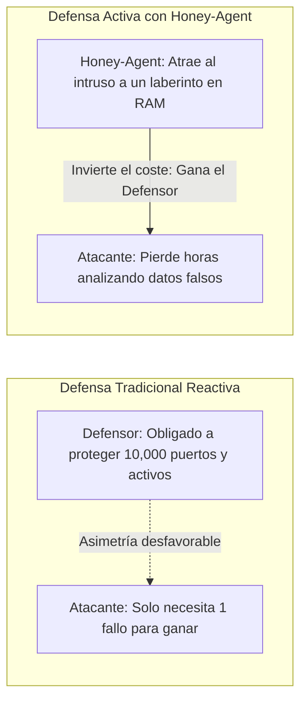
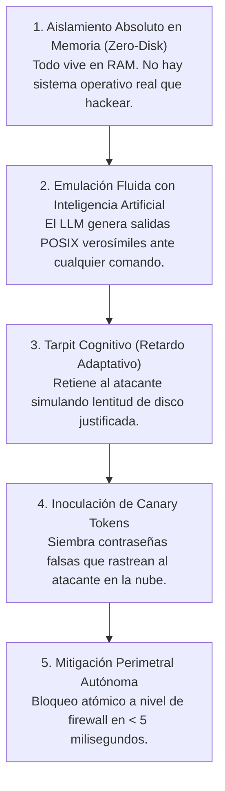

# **Whitepaper: Honey-Agent — Ciberdefensa Activa y Decepción Cognitiva con IA**

* **Documento Público:** Whitepaper Conceptual y Explicación General
* **Audiencia:** Directores de TI (CIOs), Directores de Seguridad (CISOs), Evaluadores y Analistas
* **Versión:** 1.0 (Pública)

---

## **1. Resumen Ejecutivo**

Durante décadas, la ciberseguridad corporativa ha operado bajo un paradigma puramente **reactivo y asimétrico**: las organizaciones invierten millones de dólares intentando blindar el 100% de sus sistemas, mientras que a los cibercriminales les basta con descubrir una única brecha para comprometer toda la red. 

Los sistemas defensivos tradicionales (firewalls perimetrales, sistemas de detección de intrusos e IPS) operan bajo una lógica binaria: **permiten el tráfico o lo bloquean de inmediato**. Esta respuesta inmediata entrega retroalimentación gratuita al atacante, permitiéndole probar miles de variantes de malware hasta encontrar una que pase inadvertida, a coste cero.

**Honey-Agent** invierte esta asimetría introduciendo el concepto de **Decepción Cognitiva Activa en Memoria**:
1. Atrae al adversario hacia un entorno sintético indistinguible de un servidor corporativo en producción.
2. Genera respuestas dinámicas y creíbles utilizando Inteligencia Artificial generativa.
3. Desgasta el tiempo, las herramientas y la paciencia del intruso mediante micro-retardos adaptativos (*Cognitive Tarpit*).
4. Le entrega credenciales trampa firmadas (*Canary Tokens*) que alertan a toda la organización si son usadas fuera del señuelo.
5. Expulsa al atacante a nivel de red en milisegundos cuando detecta intenciones destructivas.

---

## **2. El Problema: La Asimetría de la Ciberseguridad Moderna**

### **Las tres limitaciones de los honeypots tradicionales:**
1. **Honeypots estáticos (de baja interacción):** Tienen respuestas fijas preprogramadas. Cualquier atacante medianamente preparado los detecta en 5 segundos porque faltan comandos comunes de Linux.
2. **Entornos reales vulnerables (sandboxes de alta interacción):** Si bien son creíbles, conllevan el peligro latente de que el atacante escape del entorno de pruebas y utilice el servidor como punto de apoyo (*pivot*) para infectar el resto de la empresa.
3. **Falta de contención activa:** La mayoría de los señuelos se limitan a guardar registros en archivos de texto, esperando que un analista humano los revise horas o días después.

---

## **3. Los Cinco Pilares de Honey-Agent**

Honey-Agent supera las limitaciones anteriores mediante la convergencia de cinco pilares tecnológicos:

### **Pilar 1: Aislamiento Absoluto en Memoria Volátil (Zero-Disk)**
Todo el entorno que el atacante explora (archivos, directorios, variables de usuario) reside exclusivamente en la memoria RAM del proceso. **No se escribe ningún archivo en el disco duro del servidor host ni se ejecutan terminales reales (`/bin/bash`)**. Cuando la sesión finaliza o el atacante es expulsado, el estado se evapora al instante. No hay posibilidad matemática de escape del señuelo.

### **Pilar 2: Emulación Fluida con Inteligencia Artificial**
En lugar de respuestas rígidas, un modelo de lenguaje interpreta la intención del atacante y genera la salida que un administrador de sistemas esperaría ver en un servidor Linux Ubuntu en producción. Soporta comandos complejos, tuberías (`ps aux | grep root`), inspección de hardware simulado y lectura de logs ficticios.

### **Pilar 3: Tarpit Cognitivo (Retardo Adaptativo)**
Los ataques automatizados dependen de la velocidad. Si un bot envía 100 comandos por segundo y recibe respuestas inmediatas, prueba miles de combinaciones en minutos.
El **Tarpit Cognitivo** de Honey-Agent dosifica los tiempos de respuesta:
* Comandos simples (`whoami`, `id`) responden al instante para generar confianza.
* Búsquedas profundas (`find /`, `grep -r`) tardan varios segundos calculados probabilísticamente.
* El atacante cree que el servidor está saturado por una carga de trabajo pesada y espera pacientemente, desperdiciando su tiempo y entregando valiosa telemetría a los defensores.

### **Pilar 4: Inoculación de Contra-Inteligencia (Canary Tokens)**
Cuando el intruso inspecciona archivos sensibles típicos como `/var/www/html/.env` o `~/.aws/credentials`, Honey-Agent genera credenciales falsas firmadas criptográficamente. Si el atacante intenta utilizar esas credenciales para autenticarse en servicios reales de Amazon Web Services, bases de datos o VPNs corporativas, las alertas perimetrales se disparan de forma instantánea y no repudiable.

### **Pilar 5: Mitigación Perimetral Autónoma en Tiempo Real**
Honey-Agent no espera a que un operador humano lea un reporte para actuar. Si el atacante ejecuta un payload de alto riesgo (como la descarga de un script malicioso o un intento de rootkit), el sistema despacha una regla de bloqueo a nivel de red (`iptables DROP` en Linux o regla de Firewall en Windows) en menos de 5 milisegundos, congelando su terminal de forma inmediata.

---

## **4. Beneficios Estratégicos para las Organizaciones**

| Beneficio Estratégico | Impacto en la Organización |
| :--- | :--- |
| **Detección con Cero Falsos Positivos** | Nadie legítimo tiene motivos para interactuar con un servidor señuelo. Cualquier conexión entrante es, por definición, un intento de acceso no autorizado con 100% de certeza. |
| **Desgaste Económico del Adversario** | Obliga a los atacantes a invertir horas de trabajo analizando información sintética sin valor, multiplicando el coste operativo de las campañas hostiles. |
| **Tiempo Táctico para el SOC** | Mientras el atacante se encuentra entretenido dentro del laberinto en memoria, el equipo de ciberseguridad tiene tiempo suficiente para auditar la procedencia del intruso y reforzar sus sistemas principales. |
| **Inteligencia de Amenazas Accionable** | Cada comando, herramienta y técnica empleada se clasifica automáticamente bajo el estándar **MITRE ATT&CK** y se exporta a plataformas SIEM/SOAR. |

---

## **5. Conclusión**

Honey-Agent transforma la postura de seguridad de una organización, pasando de una actitud pasiva y vulnerable a una **estrategia de defensa activa y disuasión proactiva**. Al convertir la infraestructura en un laberinto inteligente, la ventaja táctica regresa a manos de los defensores.
